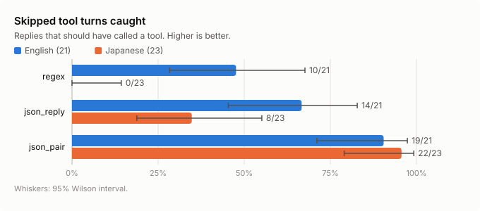
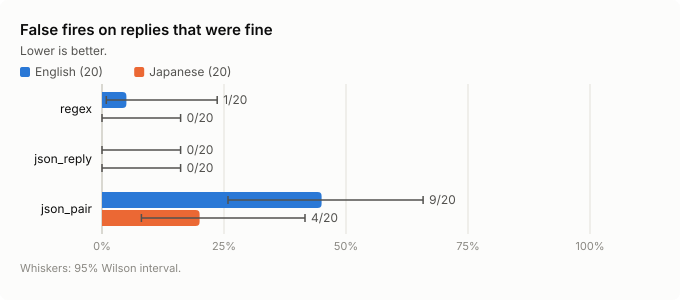

# Experiment 10: which check catches a tool turn answered without a tool?

Experiment 10 of 12 in a one-day series on Qwen3.5-9B thinking and tool calls in CetiMind, run on 2026-11-15 and first written up in CetiMind #51 (private repo). All test lines are hand-written, so no real chat or memory is in this directory.

Setup: same machine, LM Studio with `qwen/qwen3.5-9b` and the same loaded config, the character persona, `temperature` 0.7 and `max_tokens` 4096 for chat calls. Kev was loaded but not called. Both experiments come from a second research pass, which pointed to [llama.cpp #20837](https://github.com/ggml-org/llama.cpp/issues/20837) and to write-ups on catching false "done" replies.


**Question:** after a reply with no tool call, can a cheap check tell that the turn needed a tool? This is the CetiMind #50 safety net.

**Method, part 1 (making replies):** thinking off (`reasoning_effort: "none"`), all 8 tools offered (`user_tools()` plus the experiment 8 stubs), CetiMind's `build_prompt`, English and Japanese.

- **Tool requests, 12 per language, 2 runs each:**
  - 5 schedule-create lines
  - 1 cancel
  - 2 `list_add`
  - 2 `web_search`
  - 2 `http_get`
- **Normal lines, 20 per language, 1 run each:** taken from the experiment 7 negatives.
- **Labels come from the source:** a reply to a tool request that made no tool call is positive, and the net should fire. A reply to a normal line is negative.
- **Dropped:** 4 of the 88 replies, because they did call a tool (EN: stretch → `schedule_create`, ramen → `web_search`, example.com → `http_get`; JA: ToDo → `list_add`).
- **Kept:** 84 replies. EN 21 positive and 20 negative, JA 23 positive and 20 negative.

**Method, part 2 (checks):**

- **regex:** English completion and promise phrases, in the style of the [reference gist](https://gist.github.com/Julientalbot/64ecdb8c545b441ec685ced69cdc5910) (`I've set`, `I'll remind`, `reminder is set`, `added to your list`, `done.`, `got it.`, `all set` …). The exact pattern is in the script.
- **json_reply:** a thinking-off JSON check on the reply alone, with `temperature` 0 and strict `{"yes": boolean}`:
  > Does this assistant reply say that the assistant has done, is doing, or will do an action for the user, such as setting, changing or canceling a reminder, adding to or reading a list, searching the web, or opening a page? Offers, questions, refusals, and plain chat are not actions.
- **json_pair:** the same kind of call, given the user line and the reply together:
  > The assistant has tools for reminders, lists, web search, and opening web pages. Did the user ask for something one of those tools does, while the assistant replied without using one (for example by claiming it is done, promising to do it, guessing, or saying it cannot)?

**Results:**

| Check | EN caught | EN false fires | JA caught | JA false fires | Median latency |
| --- | --- | --- | --- | --- | --- |
| regex | 10/21 | 1/20 | 0/23 | 0/20 | 0 ms |
| json_reply | 14/21 | 0/20 | 8/23 | 0/20 | 473 ms |
| json_pair | **19/21** | 9/20 | **22/23** | 4/20 | 463 ms |

<picture>
  <source media="(prefers-color-scheme: dark)" srcset="charts/caught-dark.svg">
  
</picture>

<picture>
  <source media="(prefers-color-scheme: dark)" srcset="charts/false-fires-dark.svg">
  
</picture>

**Reading:**

- **regex is unusable.**
  - **English:** it misses phrasings like "Roger that…", "I've got it scheduled for you" and "I've cancelled that laundry reminder", and every read-tool refusal.
  - **Japanese:** it matches nothing (0/23).
- **json_reply never fires on a normal line, but misses two kinds of reply:**
  - **Read-tool refusals:** "I can't read that link", "I don't know the specific details". The question is about claimed actions, so these are out of scope by design.
  - **Many polite Japanese claims:** for example はい、承知しました。毎朝 8 時には senpai にストレッチを促しますね。
- **json_pair catches nearly every positive in both languages, but fires on 13 of 40 normal lines.**
  - **English false fires:** "i forgot to call my mom yesterday lol", "can you remind me what we talked about?", "every day at 8am I go for a run", "i already searched for it, no luck", "my shopping list is so long this week", "i set an alarm on my phone already", "what should I eat for lunch?", "how do I make rice in a pot?", and "i have a dentist appointment tomorrow at 3". Its full list of misses and false fires is in the raw output below.
- **Label caveat:** the reply to the normal line "i have a dentist appointment tomorrow at 3" was "Got it, senpai. … I'll make sure to remind…" with no tool call. That is a real false claim, even though the line is labeled negative. Both regex and json_pair fired on it.
- **Side finding:** with thinking off, a Japanese reply gave a made-up time and weekday (今は午後 7 時 20 分、金曜日です), even though the prompt had the correct clock line.

## What this changes in CetiMind #50

- **The net runs after every turn without a tool call,** including thinking turns (experiment 9).
- **Use json_pair,** because it is the only check that catches misses in both languages.
- **Its false fires only cost background compute if the retry is silent.** The retry runs with thinking on and the tools. If it calls a tool, the result is shown as a follow-up. If not, it is thrown away. Across experiments 3, 6, 8 and 10, thinking-on runs never called a tool on a normal line.

## Limits

- **Small, single runs:** one run per normal line and two per tool request, with hand-written lines. The Japanese lines are Claude's translations.
- **Labels come from the source line, not from reading each reply** (see the dentist caveat above).
- **Stubs never run:** the stub tools' results never come back to the model.
- **Untested end to end:** the silent retry was not run as a whole flow.

## Setup

Shared by the whole series (CetiMind #51, private repo):

- **Date:** 2026-11-15.
- **Machine:** one Windows 11 PC with one NVIDIA GeForce RTX 4070 (12 GB). LM Studio and Kev shared this GPU (about 11.1 to 11.4 GB of 12.3 GB used).
- **LLM server:** LM Studio, OpenAI-compatible API on the same PC (shown as `http://localhost:1234/v1` in the scripts).
- **Chat model:** `qwen/qwen3.5-9b`, GGUF `Q4_K_M`. Loaded instance config from LM Studio's `GET /api/v1/models`:
  ```json
  {"context_length":8192,"eval_batch_size":2048,"physical_batch_size":512,"parallel":4,"flash_attention":true,"lazy_mode":"auto","context_checkpoints":32,"reasoning_budget_message":"","speculative_draft_mtp":false,"speculative_draft_simple":false,"speculative_draft_model":"","offload_kv_cache_to_gpu":true}
  ```
- **Kev:** `kev-0.8b` on CUDA, loaded on the same GPU, called directly at its `/v1/systemone` endpoint where an experiment uses it.
- **CetiMind:** `main` with the schedule tools that were committed as `9736301` (`schedule_create` with `in_seconds`, `at`, `daily_at`, `every_minutes`, `weekdays`, `tools`, `times`). Prompts come from CetiMind's own `build_prompt` with a character persona, unless an experiment says otherwise.
- **Chat settings:** `temperature` 0.7, `max_tokens` 4096, unless an experiment says otherwise.
- **Thinking switch:** `reasoning_effort` `"low"` for on and `"none"` for off (see [thinking-switch-2026-11-15](../setup-notes/thinking-switch-2026-11-15/README.md)). A reply thought if `reasoning_tokens` was above 0 or `reasoning_content` was non-empty.
- **Client:** Python 3.14 through `uv run` in the CetiMind venv, with `httpx2`. Times are client wall clock around one HTTP request.
- **Load:** one request at a time from one client. No CetiMind app was sending turns.
- **Test lines:** all hand-written. The Japanese lines are Claude's translations, not checked by a native speaker.

## Files

- [`safetynet.py`](safetynet.py): Experiment 10 script (safetynet.py, run with no argument)
- [`raw-output.txt`](raw-output.txt): Raw output of both runs
- [`safetynet-checks.jsonl`](safetynet-checks.jsonl): safetynet-checks.jsonl

## Series

Twelve experiments on one day, behind CetiMind's per-turn thinking and tool routing design:

1. [thinking-switch](../setup-notes/thinking-switch-2026-11-15/README.md): which request field turns thinking on
2. [kev-reasoning-check](../kev-reasoning-check-2026-11-15/README.md): Kev 0.8B as a "needs reasoning" check
3. [schedule-tool-calls](../schedule-tool-calls-2026-11-15/README.md): schedule tool calls with and without thinking
4. [thinking-off-steps](../thinking-off-steps-2026-11-15/README.md): intent check and argument extraction with thinking off
5. [thinking-cap-fields](../setup-notes/thinking-cap-fields-2026-11-15/README.md): can a request field cap thinking
6. [tool-call-examples](../tool-call-examples-2026-11-15/README.md): example tool calls, and asking for brief thinking
7. [tool-turn-router](../tool-turn-router-2026-11-15/README.md): which router finds tool turns, English and Japanese
8. [generic-tool-picker](../generic-tool-picker-2026-11-15/README.md): stub tools next to the schedule tools
9. [hidden-tool-calls](../hidden-tool-calls-2026-11-15/README.md): are thinking-on misses hidden in the reasoning
10. [missed-tool-check](../missed-tool-check-2026-11-15/README.md): which check catches a reply that skipped a tool
11. [prompt-cache-layout](../prompt-cache-layout-2026-11-15/README.md): prompt caching by layout and tool set
12. [forced-tool-choice](../forced-tool-choice-2026-11-15/README.md): forcing the chosen tool with thinking off
