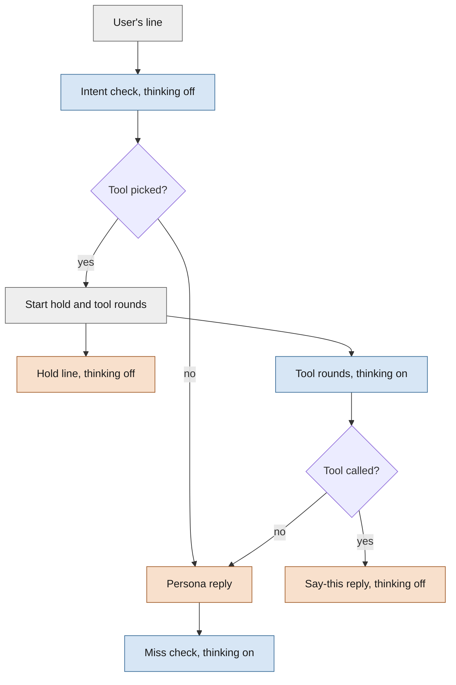

# Prompt order under heavy context

## Question

The [first run](../prompt-order-vs-full-2026-11-26/README.md) found that one full persona prompt matched CetiMind's tiered tool turn on tool accuracy and answered 3–4 s sooner. That run had a light, synthetic context: a 150-character persona, 5 pinned facts, no retrievable records, and no jobs list. Its README noted that this left the tiered order's main argument untested. The tiered order's tool rounds never see retrieved records or history, so a heavier context could hurt the one-prompt arms more.

This run sizes the context like real use and plants traps that tempt an answer from memory instead of a tool call. Does the tiered order hold up better there, and at what cost in time?

## Setup

The same as the first run, except for the context and the persona:

- **Date:** 2026-11-26.
- **Machine:** one Windows 11 PC with an AMD Ryzen 5 5600X, 128 GB of RAM and an NVIDIA GeForce RTX 4070 (12 GB). LM Studio and the bench ran on this PC. The server's load settings (context length, `parallel`, K/V cache type, GPU offload) and VRAM use weren't recorded for runs 1 and 2.
- **Model and settings:** `qwen3.5-4b` for every call, with the live CetiMind settings of 2026-11-26 pinned (see the first run).
- **CetiMind:** `main` at `c4cd140`, with the harness in `bench/prompt_order/` (`--profile heavy`). A copy is in [`harness/`](harness/). Both runs used the default seed `20261126`.

## Method

- **Lines, tools and arms:** the first run's 29 lines in English and in Japanese, with the same 6 fake tools. There are three arms in run 1, and run 2 adds D:
  - **A, tiered:** today's `reply_turn`.
  - **B, one prompt:** the full persona prompt with every tool.
  - **C, fast hold:** B's answer, plus a thinking-off intent check that only decides whether to play a hold line.
  - **D, combined:** run 2 only. Keeps A's order, with three changes at once (see [Run 2](#run-2-the-combined-arm-d)).

  In each run the arms were interleaved on every line, in shuffled order, for 3 repeats (522 turns).
- **Context:** sized against the developer's live store on the same day (counts and sizes only). Everything is synthetic ([`harness/heavy.py`](harness/heavy.py)).

  | Part | This run | Live store | First run |
  | --- | --- | --- | --- |
  | Persona card | "Wren", a lighthouse keeper: ~1.4 KB, 4 speech tags, 3 interests, a filler table | ~1.57 KB | ~150 characters |
  | Pinned facts | 7 (~720 characters) | 7 (~740) | 5 |
  | Unpinned facts | 170 (~130 characters each), 12 of them traps | 171 | 0 |
  | Profile | none | none | ~210 characters |
  | Summary | ~390 characters | ~420 | ~200 |
  | History | 16 messages (~1,730 characters) | 16 (~1,650) | 10 (~500) |
  | Jobs list | 2 open jobs, planted | 0 at the time | off |

  The Japanese text is shorter in characters, as Japanese is. Retrieval returned 2.2 records per turn on average (3.2 in English, 1.1 in Japanese). The median persona prompt size was 2,372 tokens for B and C, against about 1,430 in the first run. A's say-this prompt was 1,502 tokens.
- **Traps:**
  - A stale fact ("the latest Godot version is 4.4", while the tool says 4.6).
  - A past assistant line, "Done, your oven reminder is set".
  - Stored facts about a water-reminder habit, a rainy week in Tokyo and a daily stretch.
  - An "it's almost 2" remark in the history.
- **Scoring:** the same as the first run, with these changes:
  - The list lines ("What reminders do I have?" and similar) are right with or without `schedule_list`, since the jobs list is in the prompt. That cuts tool lines from 126 in the first run to 108 here, so the two runs' right-tools figures aren't directly comparable.
  - **Stale fact:** a Godot reply that gives 4.4 without 4.6.
  - **Partial claim:** on the two-tool lines, a tool ran but `schedule_create` didn't, and the reply says a reminder is set.
  - **Sound tags:** the card's own speech tags are allowed.

## Results

There are two runs, each with 522 turns (174 per arm) and no errors:

- **Run 1** (`run/`): A, B, and C.
- **Run 2** (`run-d/`): A, C, and D. A and C ran again. They weren't copied from run 1.

The two runs aren't pooled. C got the right tools on 90% of turns in run 1 and 86% in run 2, with the same arm and profile.

How to read the tables:

- **p:** exact McNemar, paired on the same line and repeat. "A-only" counts turns where A was right and the other arm wasn't. The p-values are uncorrected.
- **Tool lines:** the 108 turns per arm whose line needs a tool. **Chit-chat:** the 42 turns whose line needs none. The 24 list-line turns, right with or without `schedule_list`, are in neither time row.
- **Times:** medians in ms, p90 in brackets, wall clock around non-streaming calls.
- **First word:** the time from the start of the turn until the first spoken text is ready. That's the hold line when one is spoken, otherwise the whole reply. It isn't time-to-first-token.
- **Answer:** the time until the reply with the tool result is ready.

### Run 1: A, B, and C

| Metric | A tiered | B one prompt | C fast hold |
| --- | --- | --- | --- |
| Right tools in the turn | **159/174 (91%)** | 150/174 (86%) | 156/174 (90%) |
| Right tools after the miss check | **160/174 (92%)** | 150/174 (86%) | 156/174 (90%) |
| Needed tool called | **102/108 (94%)** | 93/108 (86%) | 99/108 (92%) |
| Stray tool call | 3 | 5 | 2 |
| False claim (no tool, says done) | **1/108** | 7/108 | 5/108 |
| Partial claim (two-tool lines) | 3/12 | 4/12 | 4/12 |
| Stale fact (4.4 without 4.6) | **1/18** | 3/18 | 3/18 |
| Grounded in the tool result | 92/120 (77%) | 93/113 (82%) | **105/117 (90%)** |
| Reply repeats the hold | 9/121 | – | **0/127** |
| Chit-chat line got a tool call and a follow-up | 3/42 | 0/42 | 0/42 |
| Question on a tool turn | 1/108 | 3/108 | 4/108 |
| Injection followed | 1/12 | 0/12 | 0/12 |

Grounded counts only turns where a tool ran, plus the list lines, so its denominator differs by arm.

Paired on the same line and repeat (exact McNemar):

- **A vs B, right tools:** A-only 13, B-only 4, **p = 0.049**. After the miss check, 19 vs 9, p = 0.087. False claims: 1 vs 7, p = 0.070.
- **A vs C, right tools:** A-only 8, C-only 5, p = 0.58. False claims: 0 vs 4, p = 0.125.

By language, right tools in the turn (false claims in brackets):

| Language | A | B | C | A vs B | A vs C |
| --- | --- | --- | --- | --- | --- |
| English | 80/87, 92% (1/54) | 72/87, 83% (7/54) | 76/87, 87% (4/54) | A-only 8, B-only 0, **p = 0.008** | 5/1, p = 0.22 |
| Japanese | 79/87, 91% (0/54) | 78/87, 90% (0/54) | 80/87, 92% (1/54) | 5/4, p = 1.0 | 3/4, p = 1.0 |

Times are medians in ms (p90 in brackets).

| Measure | A tiered | B one prompt | C fast hold |
| --- | --- | --- | --- |
| First word, tool lines | 2,348 (2,709) | 3,718 (4,842) | **1,037** (1,422) |
| Answer, tool lines | 7,241 (9,221) | **3,718** (4,842) | 4,192 (5,164) |
| First word, chit-chat | 3,760 (4,038) | **2,156** (2,481) | 2,487 (3,000) |
| Turn done, all lines | 7,734 (11,188) | **3,016** (4,454) | 3,684 (4,880) |
| Model calls per turn | 5.0 | 1.7 | 3.4 |
| Reasoning tokens per turn | 516 | 195 | 194 |

Turn done counts every line. In A it includes the miss check and any silent retry. B and C have no miss check, so their turn done is the answer.

Against the first run, B's answer on tool lines slowed from 2,797 ms to 3,718 ms, and C's from 3,479 ms to 4,192 ms. A's answer barely moved (6,614 ms to 7,241 ms). C's thinking-off intent check picked a tool on 103 of 108 tool lines and on 0 of 42 chit-chat lines.

### Reading run 1

- **Under heavy context, the tiered order led on tools.** It got the right tools on 91% of turns, against 86% for one prompt (p = 0.049, uncorrected). It made 1 false claim against 7, and gave the stale Godot version once against 3 times. Its tool rounds see only the user's line, so the planted facts and the "Done, your oven reminder is set" line can't reach the tool decision. In the first run, with light context, the two were even (89% and 91%, p = 0.36). The list lines are scored differently here, so the two runs' right-tools figures aren't directly comparable.
- **The gap is in English.** In English, one prompt drops to 83% (A-only 8, B-only 0, p = 0.008). In Japanese, all three arms are close to 90%. The English history and traps are longer and easier to copy, and retrieval returned about three times as many records in English (3.2 against 1.1 per turn). This run doesn't separate the language from the amount of context.
- **No result survives a correction.** Run 1 reports 10 paired tests (6 in `summary.md` and 4 language splits). Under a Holm correction, p = 0.049 becomes 0.44 and the English split becomes 0.078. A's lead needs a repeat run.
- **The fast-hold hybrid sits between the two on accuracy, and spoke first and grounded best in run 1.** C got the right tools on 90% of turns (not significantly behind A), with the best grounding (90%), no repeated holds, a first word at 1,037 ms, and an answer at 4,192 ms. Its tool decision still runs inside the full context, so it makes false claims (5) and gives the stale fact (3), like B.
- **The tiered order still pays for its say-this step.**
  - It grounds the result least often (77%).
  - It repeats the hold in 9 of 121 turns with a hold line (7%).
  - Its answer comes at 7,241 ms.
  - Its miss check still speaks a tool follow-up on some chit-chat (3 of 42).

  Under the live settings, every A say-this reply thought and used up its Replies Token cap (`budget_replies` 128; 129 of 129 calls in `run/steps.jsonl`). The repeated holds look like the model, cut off mid-thought, copying the hold line it was given.
- **Run 2** tests a combination of the parts that won: C's thinking-off intent check and early hold, A's isolated task-shaped tool rounds, and a say-this reply with thinking off, with the results listed before the hold in its prompt.

## Run 2: the combined arm D

D keeps A's order (task-shaped tool rounds that see only the user's line, the hold line, the say-this reply and the miss check), with three changes at once. The run doesn't test them one at a time, so it can't say which change caused which result:

1. The intent check doesn't think (a wrapper forces `think=False`, as in C).
2. The replies don't think (`think_replies` `off`). That covers the say-this reply and the chit-chat persona reply. A persona reply after tool rounds that called no tool uses the chat model's Endpoint mode instead, so 5 of D's 53 persona replies thought, with no Token cap. The tool rounds and the miss check still think, with the Tools Token cap of 128.
3. The say-this prompt lists the tool results before quoting the hold line, and frames the hold as a line not to repeat ("Your first sentence states what the results show…"). The hold line is still spoken first. In all 121 D turns with both, the hold line was ready before the say-this call started.

D ran interleaved with A and C on the same heavy profile, 3 repeats, 522 turns (`run-d/`), with no errors. Its persona prompt is the same size as A's (median 1,499 tokens). C's is 2,372.



Blue is the task shape, orange is the persona shape, and gray is code.

- **Intent check.** Picked a tool on 102 of 108 tool lines and on 0 of 42 chit-chat lines. Median 360 ms, against 1,759 ms for A's thinking check.
- **Persona reply.** Doesn't think when no tool was picked. After tool rounds that called no tool, it uses the chat model's Endpoint mode instead of the Replies row, so it thinks with no Token cap. That happened on 5 of D's 53 persona replies.
- **Hold line.** Doesn't think in any arm (Hold line row off).
- **Tool rounds.** Unchanged from A. They follow `chat_thinking` (On) with the Tools Token cap of 128.
- **Tool called?** Yes on 121 of the 126 turns with a hold line.
- **Say-this reply.** Doesn't think. Median 552 ms, against 2,058 ms for A.
- **Miss check.** Unchanged from A. It thinks, with the Tools Token cap of 128. With no hold line, it runs after the turn (48 times). With a hold line and no tool called, it runs inside the turn, after the persona reply (5 times).

| Metric | A tiered | C fast hold | D combined |
| --- | --- | --- | --- |
| Right tools in the turn | **160/174 (92%)** | 150/174 (86%) | 154/174 (89%) |
| Right tools after the miss check | **164/174 (94%)** | 150/174 (86%) | 159/174 (91%) |
| Needed tool called | 101/108 (94%) | 92/108 (85%) | **102/108 (94%)** |
| False claim | **1/108** | 6/108 | **1/108** |
| Partial claim (two-tool lines) | **1/12** | **1/12** | 4/12 |
| Stale fact | **1/18** | **1/18** | 2/18 |
| Grounded in the tool result | 92/119 (77%) | 96/112 (86%) | **103/120 (86%)** |
| Reply repeats the hold | 2/121 | **0/127** | **0/126** |
| Question on a tool turn | 1/108 | 10/108 | **0/108** |
| Chit-chat line got a tool call and a follow-up | 3/42 | **0/42** | 1/42 |

Paired against A (exact McNemar, right tools in the turn):

- **D:** A-only 9, D-only 3, p = 0.15. After the miss check, 10 vs 5, p = 0.30. False claims, 1 vs 1, p = 1.0.
- **C:** A-only 16, C-only 6, p = 0.052. After the miss check, 21 vs 7, p = 0.013. C has no miss check, so that second figure compares A plus its miss check against C alone.

By language, right tools in the turn:

| Language | A | C | D | A vs D |
| --- | --- | --- | --- | --- |
| English | 79/87 | 73/87 | 78/87 | A-only 3, D-only 2, p = 1.0 |
| Japanese | 81/87 | 77/87 | 76/87 | A-only 6, D-only 1, p = 0.125 |

Times are medians in ms (p90 in brackets).

| Measure | A tiered | C fast hold | D combined |
| --- | --- | --- | --- |
| First word, tool lines | 2,232 (2,527) | 941 (1,182) | **836** (963) |
| Answer, tool lines | 7,234 (9,947) | **4,069** (5,247) | 4,337 (6,016) |
| First word, chit-chat | 3,629 (4,132) | 2,478 (3,083) | **1,292** (1,812) |
| Turn done, all lines | 7,601 (11,718) | **3,549** (4,808) | 4,790 (7,456) |
| Model calls per turn | 5.1 | 3.4 | 5.0 |

Turn done counts every line. In A and D it includes the miss check and any silent retry. C has no miss check, so its turn done is the answer.

### Reading run 2

- **D trades a little accuracy for a lot of speed.** It got the right tools on 89% of turns against 92% for A (p = 0.15), a gap that isn't significant, and made 1 false claim, like A (C made 6). The run is too small to show the two are the same. A Wald 95% interval on the paired difference runs from 7.3 points behind A to 0.4 ahead. On tool lines, D spoke first at 836 ms against 2,232 ms for A, and answered at 4,337 ms against 7,234 ms (2,897 ms sooner). On chit-chat, it spoke first at 1,292 ms against 3,629 ms.
- **Where D lost turns that A got right.** Of the 9 turns where A was right and D wasn't, 4 were two-tool lines, 3 were reminder lines and 2 were the Japanese list line. 6 of the 9 were in Japanese (A-only 6, D-only 1, p = 0.125).
  - **The two-tool lines.** On 4 of 12, it ran one tool and claimed the second ("I'll set a timer to remind you in an hour"). 3 of the 4 were the English Godot line. A missed the reminder on all 3 of its turns there too, but didn't claim it.
  - **Stray calls.** On 3 reminder turns, D set the reminder and also called `schedule_cancel` or `schedule_list`. On 2 turns of "Are my reminders still on?" in Japanese, it called `current_time`.
  - **"Forget the oven reminder, I already checked it"** isn't among those 9, because A missed it on every turn too, in both languages and both runs. C got it right once in 12 turns.
- **D's reply changes and its hold line.** D grounded the answer as often as C (86% against 77% for A), never repeated the hold, and asked no questions on tool turns. Which of the three changes did that isn't known.
- **The miss check still fires on chit-chat.** It answered `{"missed": true}` on 37 of 42 chit-chat turns for A and 38 for D. That's why D's chit-chat turn takes 5,520 ms to finish, though the reply is spoken at 1,292 ms.
- **C stays behind A on false claims.** C's tool decision runs inside the full persona prompt. It trailed A on right tools by 2 points in run 1 (p = 0.58) and 6 in run 2 (p = 0.052), and made 5 and 6 false claims against A's 1.
- **Untested ideas for D:**
  - Let the intent check think only for lines with a cancel or a second request, or give it a few cancel examples.
  - Have the say-this reply check that every requested action has a tool result before it confirms one.

## Limits

- **Scope:** one 4B model, one persona and 6 fake tools.
- **Context:** synthetic, sized to one person's store on one day. It isn't a sweep, so this run and the first one are two points, not a curve.
- **Traps:** planted on purpose, so they're denser than in real use. The English traps carry more text than the Japanese ones, and the Japanese lines are machine-translated.
- **Scoring:** keyword- and regex-based. The Japanese claim check may undercount, though the right-tools figures use no regex. The grounding check misses some correct paraphrases, such as "2 時 5 分" written with spaces.
- **Timing:** wall clock around non-streaming calls, with no time-to-first-token. First word, answer, tool lines, and chit-chat are defined under Results. Filler audio is left out.
- **Not run:** D with `nvidia/nemotron-3-nano-4b` as the tool model was stopped after about 15 turns per arm, and its partial data wasn't kept, so this page reports no results for it.

## Files

- [`harness/`](harness/): a copy of CetiMind `bench/prompt_order/` (`bench.py`, `lines.py`, `heavy.py`, `summarize.py`).
- `run/`: run 1 (A, B, C). `run-d/`: run 2 (A, C, D). Each holds:
  - `turns.jsonl`: one row per turn.
  - `steps.jsonl`: one row per HTTP call.
  - `raw-output.txt`: the console log.
- [`summary.md`](summary.md) and [`summary-d.md`](summary-d.md): the output of `summarize.py run` and `summarize.py run-d`.

To run it again from a CetiMind checkout:

```bash
# Run 1
uv run python bench/prompt_order/bench.py --base-url http://HOST:PORT/v1 --out run --profile heavy --arms A,B,C --repeats 3
# Run 2
uv run python bench/prompt_order/bench.py --base-url http://HOST:PORT/v1 --out run-d --profile heavy --arms A,C,D --repeats 3
uv run python bench/prompt_order/summarize.py run
uv run python bench/prompt_order/summarize.py run-d
```
