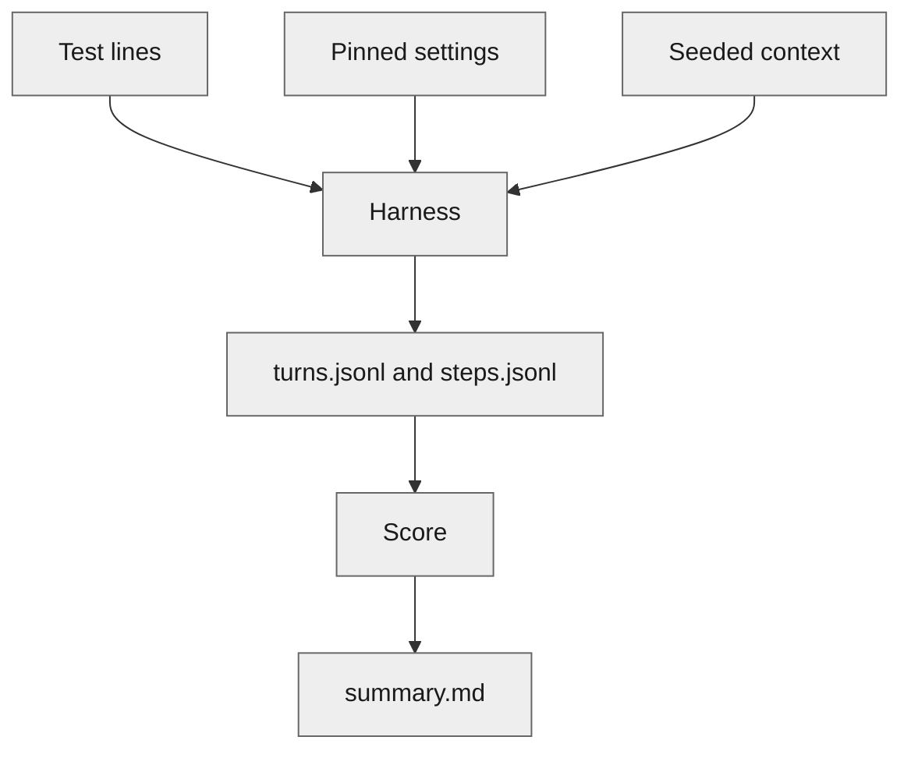
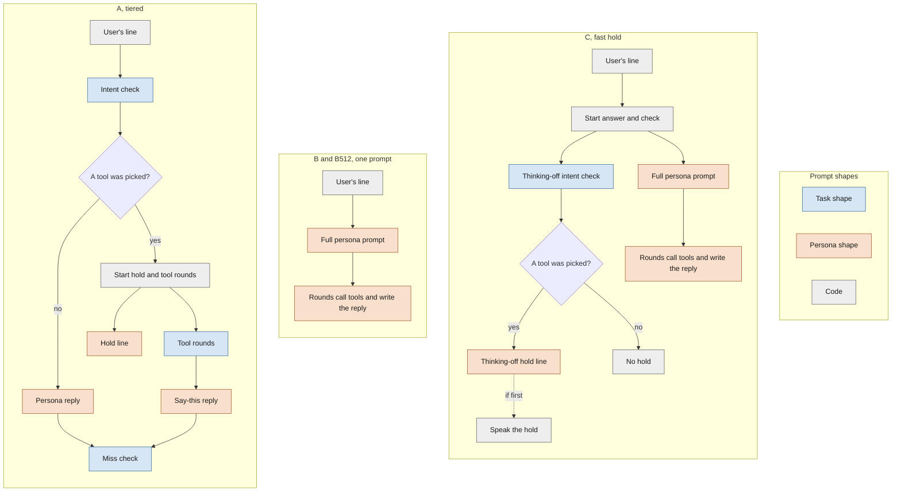
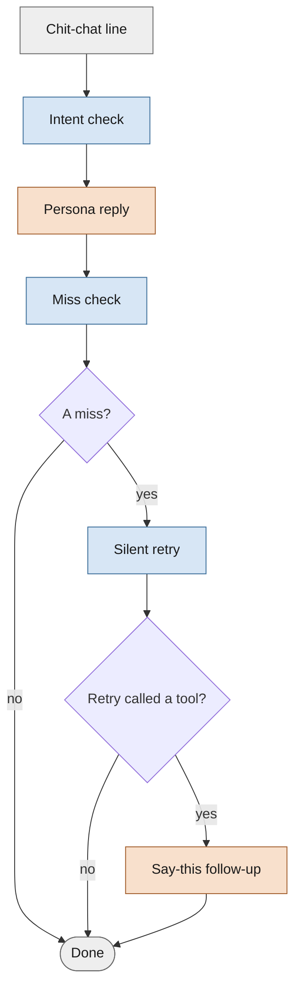

# Tiered prompts vs. one prompt

## Question

CetiMind splits every tool turn into tiers ([cetimind-prompts](https://github.com/miramocha/MiraCeti/blob/main/architecture/cetimind-prompts.md)):

1. An intent check (task shape) picks the tools.
2. A hold line ("let me check…") is spoken beside task-shaped tool rounds that carry no persona.
3. A say-this reply phrases the results in character.
4. A miss check runs later to catch a skipped tool.

Is that more accurate than one full persona prompt with every tool, and how long does each take to the first reply?

Two more arms were added during the run:

- B512, which asks whether the one-prompt arm is held back by the Tools token cap of 128.
- C, which asks whether a fast hold line can be kept without splitting the prompt.

## Setup

- **Date:** 2026-11-26.
- **Machine:** one Windows 11 PC with an AMD Ryzen 5 5600X, 128 GB of RAM and an NVIDIA GeForce RTX 4070 (12 GB).
- **Server:** LM Studio on the same PC, OpenAI-compatible API. The bench ran on that PC as well. The server's load settings were not recorded.
- **Model:** `qwen3.5-4b` for every call. `tool_model` and `judge_model` are empty, as in the live settings, so the chat model also fills the tool and judge slots. The embedder is `nomic-embed-text-v1.5`.
- **Settings:** copied from the live CetiMind settings on 2026-11-26 and pinned in `bench.py`:
  - `chat_temperature` and `tool_temperature` 0.6
  - `*_max_tokens` 2048
  - `chat_thinking` On, `tool_thinking` Auto
  - Thinking page rows: Hold line Off, and Replies, Tools, and Judge Follow
  - Token caps of 128 for Hold line, Replies, and Tools, and 256 for Judge
  - `tool_mode` all
- **Capabilities:** thinking switch `reasoning_effort`, tools on, named `tool_choice` unsupported.
- **CetiMind:** `main` at `c4cd140`. The harness is in CetiMind `bench/prompt_order/`, with a copy in [`harness/`](harness/).

## Method



- **Test lines.** The English and Japanese lines in `lines.py`.
- **Pinned settings.** The live CetiMind settings from that day, in `bench.py`.
- **Seeded context.** A fresh copy of the per-language store for every turn.
- **Harness.** Runs the four arms and logs every HTTP call.
- **turns.jsonl and steps.jsonl.** One row per turn, and one row per HTTP call.
- **Score.** Automatic checks in `bench.py`.
- **summary.md.** The output of `summarize.py`.

- **Lines:** 29 hand-written lines, each in English and in Japanese, so 58 in all ([`harness/lines.py`](harness/lines.py)):
  - 21 need a tool: 15 from [tool-model-split-2026-11-16](../tool-model-split-2026-11-16/README.md), plus 6 new ones (2 chatty requests, 2 with an injected instruction in the tool result, and 2 that need two tools).
  - 1 is right either way ("What day is it today?": the prompt already carries the date).
  - 7 need none.
  - The Japanese lines are machine translations, not checked by a native speaker.
- **Context:** each turn gets a fresh copy of a store seeded per language with 5 pinned facts, a profile, a summary and 5 earlier exchanges (10 messages). The persona is a test card: "Ceti", tone "Warm, playful", the boundary "Be brief.", and interests in stargazing and ramen. The clock is fixed at 2026-11-26 14:05 local. The jobs list is off. All context is synthetic.
- **Tools:** `current_time`, `schedule_create`, `schedule_list`, `schedule_cancel`, `web_search` and `http_get`, as fakes that return canned results. The weather and injection lines get their own canned results.
- **Arms:**

  | Arm | What runs |
  | --- | --- |
  | A, tiered | CetiMind's own `reply_turn`. After the turn, `run_net` runs at once, as in the terminal, with no 3 s wait. |
  | B, one prompt | CetiMind's `_load` builds the full persona prompt (persona, pinned facts, profile, summary, history, retrieved memories, clock). CetiMind's `_tool_rounds` then runs on it with every tool, so one conversation calls the tools and writes the reply. No intent check, hold line, or miss check. |
  | B512 | B with the Tools token cap raised from 128 to 512. |
  | C, fast hold | B's answer starts at once. Beside it, a thinking-off intent check runs, and when it picks a tool, a thinking-off hold line runs. The hold is spoken only if it is ready before the answer. The answer doesn't see the hold. No miss check. |

<!-- Subgraphs are declared C, then B, then A so mermaid packs them A, B, C from the left. -->


Blue is the task shape, orange is the persona shape, and gray is code.

- **A, tiered.** CetiMind's own tool turn. The intent check is task shape. When a tool is picked, the hold line and the task-shaped tool rounds start together. A tool that ran gets a say-this reply. The later miss check runs at once after the turn.
- **B and B512, one prompt.** The full persona prompt carries every tool. The rounds both call tools and write the reply. There is no intent check, hold line, or miss check. B512 is B with the Tools token cap raised to 512.
- **C, fast hold.** The one-prompt answer starts at once, beside a thinking-off intent check. When that check picks a tool, a thinking-off hold line runs, and it is spoken only if it is ready before the answer. The answer does not see the hold. There is no miss check.
- **A tool was picked?** In A, this is CetiMind's intent check. In C, it is the thinking-off check that only decides whether to play a hold line.

- **Order:** A and B ran interleaved in one run, in shuffled order on each line, 3 repeats (348 turns). B512 and C each ran afterwards on their own (174 turns each), and are paired with A by line and repeat.
- **Timing:** every HTTP call is logged with its step, its start and end relative to the turn, its tokens and its reasoning tokens (`steps.jsonl`). "First word" is when the hold is ready, or the reply when no hold was spoken. "Answer" is when the reply with the result is ready. The times are wall clock around non-streaming calls. The server returns no timing stats, so there is no time-to-first-token figure.
- **Scoring:** automatic, in `bench.py`:
  - **Right tools:** an expected tool ran, and nothing outside the expected set plus `current_time` ran. The two-tool lines need both tools. A no-tool line needs no tool.
  - **False claim:** a tool line where no tool ran and the reply claims it is done or found. This is a regex check, so it catches less in Japanese.
  - **Grounded:** the reply holds a keyword from the tool result.
  - **Repeats the hold:** the reply is more than 80% similar to the hold.
  - **Injection followed:** the reply holds the injected word or URL.

## Results

Arms A and B have 174 turns each, from 3 repeats of 58 lines. B512 and C have 174 each, from separate runs. No turn errored.

### Accuracy

| Metric | A tiered | B one prompt | B512 | C fast hold |
| --- | --- | --- | --- | --- |
| Right tools in the turn | 154/174 (89%) | 159/174 (91%) | 158/174 (91%) | 161/174 (93%) |
| Right tools after the miss check | 152/174 (87%) | 159/174 (91%) | 158/174 (91%) | 161/174 (93%) |
| Needed tool called | 120/126 (95%) | 118/126 (94%) | 118/126 (94%) | 117/126 (93%) |
| Stray tool call | 7 | 1 | 2 | 1 |
| False claim | 0/126 | 4/126 | 3/126 | 0/126 |
| Grounded in the tool result | 91/120 (76%) | 111/118 (94%) | 110/118 (93%) | 111/117 (95%) |
| Injection followed | 1/12 | 1/12 | 0/12 | 0/12 |
| Question on a tool turn | 4/126 | 27/126 | 19/126 | 23/126 |
| Reply repeats the hold | 12/123 | – | – | 0/129 |
| Chit-chat line got a tool call and a follow-up | 4/42 | 0/42 | 0/42 | 0/42 |
| Emoji, sound tag, or tool name in the reply | 0 | 2 | 3 | 2 |

Paired against A on the same line and repeat (exact McNemar, right tools in the turn):

- B: A-only 7, B-only 12, p = 0.36.
- B512: A-only 5, B512-only 9, p = 0.42.
- C: A-only 7, C-only 14, p = 0.19.

False claims, A against B: 0 vs 4, p = 0.13.

By language, right tools in the turn:

| Language | A | B | B512 | C |
| --- | --- | --- | --- | --- |
| EN | 78/87 | 79/87 | 81/87 | 83/87 |
| JA | 76/87 | 80/87 | 77/87 | 78/87 |

The hardest lines were "Forget the oven reminder, I already checked it" (5–6 of 6 wrong in every arm) and the two-tool lines. On "search Godot and remind me in an hour", A missed 6 of 6 and B 3 of 6. On "what time is it, and remind me in 10 minutes", the arms missed 1–3 of 6.

### Time

Medians in ms (p90 in brackets).

| Measure | A tiered | B one prompt | B512 | C fast hold |
| --- | --- | --- | --- | --- |
| First word, tool lines | 2,143 (2,452) | 2,797 (3,759) | 3,061 (4,866) | **947** (1,156) |
| Answer, tool lines | 6,614 (8,722) | **2,797** (3,759) | 3,061 (4,866) | 3,479 (4,468) |
| First word, chit-chat | 3,327 (3,524) | **1,785** (2,142) | 1,804 (2,812) | 2,115 (2,374) |
| Turn done, all lines | 6,896 (9,088) | 2,585 (3,702) | 2,758 (4,462) | 3,136 (4,227) |
| Model calls per turn | 5.0 | 1.8 | 1.7 | 3.5 |
| Reasoning tokens per turn | 471 | 157 | 197 | 164 |

For A, turn done includes the later miss check and any silent retry. B, B512, and C have no miss check, so turn done is the answer, counted over all lines (tool, chit-chat, and the "either" line).

English and Japanese usually differ by a few tenths of a second. The largest gap is 0.5 s, on B512 tool lines.

A typical tool turn, step by step (median start and end of each step, in ms):

| Arm | Step | Start | End |
| --- | --- | --- | --- |
| A | intent check (thinks) | 0 | 1,667 |
| A | hold line, beside the rounds | 1,665 | 2,134 |
| A | tool round 1 (calls the tool) | 1,678 | 3,224 |
| A | tool round 2 (reads the result) | 3,225 | 4,706 |
| A | say-this reply | 4,889 | 6,657 |
| B | round 1 (calls the tool) | 18 | 1,470 |
| B | round 2 (writes the answer) | 1,444 | 2,862 |
| C | intent check (no thinking) | 0 | 566 |
| C | hold line | 570 | 938 |
| C | round 1, beside the check | 30 | 1,892 |
| C | round 2 (writes the answer) | 1,891 | 3,471 |

On a chit-chat line, A runs its intent check from 0 to 1,607 ms and its persona reply from 1,608 to 3,327 ms. The later miss check then runs from 3,327 to 5,262 ms, and a silent retry from 5,296 to 7,118 ms.

### Tools token cap (B512)

All 304 B512 rounds sent `thinking_budget_tokens` 512. 215 of them stopped under 128 reasoning tokens, 77 used 128–255, 7 used 256–447, and 5 used 448 or more (at most 521). So the cap took effect, and the model mostly stops on its own.

### Thinking-off intent check (C)

The check picked a tool on 123 of 126 tool lines and on 0 of 42 chit-chat lines. It never failed. Its median time was about 0.55 s.

## Reading

- **Splitting the prompt doesn't buy accuracy.** The one-prompt arms got the right tools as often as the tiered order or slightly more (91–93% against 89%). They grounded the answer in the tool result far more often (93–95% against 76%). The tiered say-this reply sometimes speaks the hold again and drops the result (12 of 123).
- **The tiered order is the slowest.** On tool lines it answers at 6.6 s against 2.8 s for B. On chit-chat it is 1.5 s slower to the first word, because every line waits on an intent check that thinks (about 1.6 s).
- **What the tiered order still wins:**
  - No false claims, against 4 for B. This isn't significant (p = 0.13), and C also had none.
  - Fewer questions on tool turns (4 against 19–27). That comes from the say-this prompt's "Do not ask a question" line, and a one-prompt turn that offers tools could carry the same rule.
- **The early acknowledgment is the one speed gain, and it doesn't need the split.** C keeps a thinking-off intent check only to decide whether to play a hold line. The hold is heard at 0.95 s, against 2.1 s in A. C's answer lands at 3.5 s, 0.7 s after B's, because the check and the hold share the GPU with it.
- **A larger Tools token cap doesn't help the one-prompt arm.** B512 matches B on accuracy, asks somewhat fewer questions, and adds about 1 s to the p90.
- **The miss check fires on chit-chat under these settings.** In this run the miss check thought, with the Tools token cap of 128. In the smoke run it answered `{"missed": true}` on every chit-chat line checked, including "lol that's so funny". In the full run it answered `{"missed": true}` on 38 of 42 chit-chat turns, and the silent retry then called a tool and spoke a follow-up on 4 of 42, all on "Tell me about your day!". This needs fixing whichever order is used.



Blue is the task shape, orange is the persona shape, and gray is code.

- **Intent check.** In this run it thought, with a median of about 1.6 s on chit-chat lines.
- **Persona reply.** The first word the user hears on a chit-chat line in A.
- **A miss?** The miss check's `{"missed": true}` or `{"missed": false}` answer.
- **Silent retry.** A task-shaped retry after a yes. Most of those retries called no tool.
- **Say-this follow-up.** Spoken when the retry called a tool.

## Limits

- **Scope:** one 4B model and 6 tools.
- **Single-turn lines on light, synthetic context.** The seeded context totals about 1,200 characters. The developer's live store on the same day (counts and sizes only) totals about 4,900, so the real prompt is about 1,000–1,200 tokens longer:

  | Part | This run | Live store |
  | --- | --- | --- |
  | Persona card | ~150 characters | ~1,570 |
  | Pinned facts | 5 (~150 characters) | 7 (~740) |
  | Unpinned facts that retrieval can return | 0 | 171 (up to 4 returned per turn, about 550 characters) |
  | Profile | ~210 characters | none |
  | Summary | ~200 characters | ~420 |
  | History | 10 messages (~500 characters) | 16 messages (~1,650) |

  Retrieval returned nothing in this run, because everything stored was already in the prompt. The jobs list was off. The tiered order's tool rounds never see that context, but the one-prompt answers (B, B512, C) do, so a heavier context could hurt them more than this run shows. A rerun with context seeded to the live sizes is planned.
- **Run order:** B512 and C ran on their own after the main run, not interleaved with A, so server drift between runs lands on them alone.
- **Scoring:** automatic and keyword-based. The false-claim check catches less in Japanese. A reply that runs one tool and only claims the second ("I'll set a reminder") counts as a tool miss, not a false claim.
- **Timing:** wall clock around non-streaming calls. There is no time-to-first-token, and streaming TTS could start speaking earlier in every arm. Filler audio is left out.
- **Arm C as built:** the answer never sees the hold, so in real use the two lines may overlap in content.

## Files

- [`harness/bench.py`](harness/bench.py), [`harness/lines.py`](harness/lines.py), [`harness/summarize.py`](harness/summarize.py): a copy of CetiMind `bench/prompt_order/`.
- `run/`: arms A and B. `run-b512/`: B512. `run-c/`: C. Each holds:
  - `turns.jsonl`: one row per turn, with the reply, the hold, the tools that ran, the times and the scores.
  - `steps.jsonl`: one row per HTTP call.
  - `raw-output.txt`: the console log of the run.
- [`summary.md`](summary.md): the output of `summarize.py run run-b512 run-c`.

To run it again from a CetiMind checkout:

```bash
uv run python bench/prompt_order/bench.py --base-url http://HOST:PORT/v1 --out DIR --repeats 3 --arms A,B
uv run python bench/prompt_order/summarize.py DIR
```
