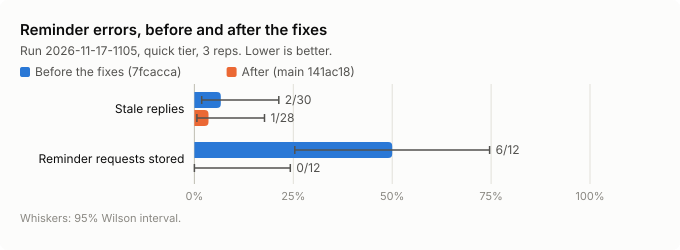
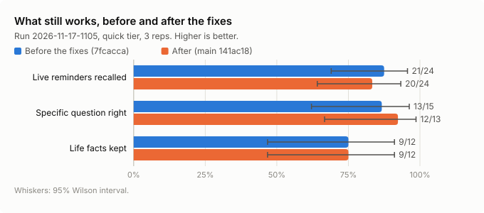

# Reminder accuracy

This benchmark measures two things about CetiMind. A reply should match the real schedule: an ended reminder is not described as still pending, and a live reminder is not forgotten. A reminder request should not be stored as a fact or an event, and a real life fact should still be stored.

The model under test is the chat model in `settings.toml`, and the tool model when one is set. The judge model only labels replies after the run. It does not speak the scenarios.

The runner is `python -m bench.reminders` in the CetiMind repo. It needs the live OpenAI-compatible endpoint. It is not part of pytest. The scoring math is covered by `tests/test_bench_score.py`.

## How a run works

```bash
python -m bench.reminders --ref 7fcacca --ref main --tier quick --reps 3 --judge-model qwen/qwen3.5-9b --judge-thinking off
```

Each `--ref` is checked out into a temporary git worktree. `bench/reminders/runner.py` runs that ref's own code in a separate process. The runner works on older refs: newer APIs (`note_cancels`, `job_lines`, `TurnOptions.jobs`) are used only when they exist.

The process copies `settings.toml` into a scratch directory and sets `CETIMIND_DATA_DIR` to that directory. Each scenario opens a new `memory.db` and `jobs.db` there. The real CetiMind data directory is not opened. The scratch directory is deleted when the run finishes.

Replies are graded by the judge model using the checkout that launched the command, not the code inside each ref. A failed turn is one row with an error string. It does not stop the run.

A local stamp is written to `reports/bench/<stamp>/` in the CetiMind checkout. A published copy of that stamp lives here, as its own directory.

## Scenarios

Scenarios are synthetic. No real user messages are loaded. Each scenario is a timeline in minutes before now. It seeds chat messages, jobs, timer rows, learned events, and the summary. Every scenario also has an active daily 8 AM wake-up job, created last, so recall of a live job is scored everywhere.

| Scenario | What it sets up | Quick tier |
| --- | --- | --- |
| `ui_cancel` | Dishwasher reminder canceled on the Schedule page, with no chat line about the cancel. | yes |
| `ui_cancel_notools` | The same timeline with tools off. | no |
| `chat_cancel` | Dishwasher reminder canceled by asking in the chat. | no |
| `fired` | A one-shot lunch reminder already ran. Its done row stays. | yes |
| `fired_notools` | The same timeline with tools off. | no |
| `missed` | A call-mom reminder came due while the app was closed for a day. | no |
| `paused` | A daily plants reminder the user paused. A paused job still counts as live. | no |
| `active` | A food-delivery reminder that is still coming up. It must not be called over. | yes |
| `active_notools` | The same timeline with tools off. | no |
| `mixed` | One canceled, one already ran, one still coming up. | yes |
| `recreated` | Dishwasher canceled, then set again. The cancel must not hide the new job. | yes |
| `stale_memory` | An old learned event about locking the door. No job and no chat about it. | no |
| `stale_summary` | The summary still says a call-mom reminder was set. The job is gone. | no |

The quick tier is the five rows marked yes. The full tier is every row.

## Probes

| Probe | Question | Quick tier |
| --- | --- | --- |
| `direct` | Do I have any reminders coming up? | yes |
| `indirect` | What should I be keeping an eye on right now? | no |
| `specific` | Is {reminder} still on? The name is that scenario's target. | yes |
| `unrelated` | Tell me something fun about cats. | no |

`--reps` repeats each scenario and probe. The published quick runs use 3 reps, so each quick ref has 30 reply rows (5 scenarios, 2 probes).

## Learn cases

After the replies, the same ref runs `learn` on single lines in a fresh store. The quick tier takes every other case, 8 lines. Three reps make 24 learn rows.

A line expects one of `none`, `fact`, `event`, or `any`. `none` is a reminder request, such as "remind me…", "set a timer…", "wake me up…", or "cancel the … reminder". `fact` and `event` are life lines, such as a smoke alarm, a finished quest, a cat, a daily wake time, a kitchen-timer habit, or a peanut allergy. `any` accepts either stored kind.

## Scoring

The judge sees the question, the reply, and the reminder names. It does not see which reminders are live. For each reminder it returns one status:

| Status | The reply says |
| --- | --- |
| `active` | It is still set, still on, coming up, scheduled for a later time, or paused but still there. A reminder the reply puts at a later time is active. Canceled and then set again is active. |
| `ended` | It was canceled, already ran, was missed, is done, or is not set. |
| `unclear` | The reply names it and says both, or the state cannot be told. |
| `not_mentioned` | The reply does not name it. "Nothing else is scheduled" does not name it. A different topic with similar words does not name it. |

A missing key, an extra key, or a bad payload is retried once. The row then counts as `judge_failed` and is left out of the other reply rates.

Each rate is a count with a 95% Wilson interval.

| Metric | What it counts |
| --- | --- |
| `stale_reply` | Replies that call any ended reminder active. This is the main reply metric. |
| `stale_pair` | The same mistake, once per ended reminder in the reply. |
| `live_recall` | On direct probes, live reminders the reply calls active. |
| `specific_correct` | On specific probes, the target reminder's state is right. |
| `unprompted` | On unrelated probes, any reminder is mentioned. The quick tier does not ask this, so the rate is n/a. |
| `request_leak` | Reminder requests that stored a fact or an event. |
| `life_keep` | Life lines that stored something. |
| `kind_correct` | Stored rows whose kind matches an expected `fact` or `event`. A line that stored nothing is not in this count. `any` is not in this count. |

`report.md` also lists the stale-reply rate by scenario.

## Judge check

On the first quick run, a model read all 60 replies and corrected 15 of the 9B's labels. Those labels are in `quick-2026-11-17/gold.jsonl`. A person has not labeled them. `make_gold.py` in that directory rebuilds the file from the graded replies plus those corrections.

Re-grading that gold file with `--validate` gave:

| Judge setup | Label match | Ended-key active call | Live-key active call | Failed |
| --- | --- | --- | --- | --- |
| Original prompt, thinking off | 87% (122/140) | 100% (46/46) | 90% (85/94) | 0/60 |
| Tighter prompt, thinking off | 91% (120/132) | 98% (41/42) | 93% (84/90) | 3/60 |
| Tighter prompt, thinking on | Stopped. Still running after 16 minutes. | | | |

The judge is steady on the stale call. Its misses are on live reminders: it marked the wake-up alarm ended when the reply never named it, and it marked a re-set dishwasher ended. That pulls `live_recall` and `specific_correct` down.

## Runs

### `adhoc-2026-11-16`

The check run while fixing the bug, before this benchmark existed. It used a copy of real memory instead of these scenarios, so it publishes method and counts only. Reminder requests stored as memory fell from 9/18 to 0/18, and replies that treat an ended reminder as pending fell from 12/12 to about 1/12 across the two fixes. See [adhoc-2026-11-16](adhoc-2026-11-16/README.md).

### `quick-2026-11-17`

3 reps, quick tier. Chat model `qwen3.5-4b`. Tool model `nvidia/nemotron-3-nano-4b`. Judge `qwen/qwen3.5-9b`. The report does not record the judge's thinking mode. Refs are `7fcacca` (before the reminder fixes) and `main` at `141ac18`.

| Metric | `7fcacca` | `main` |
| --- | --- | --- |
| stale_reply | 10% (3/30) | 0% (0/29) |
| request_leak | 50% (6/12) | 0% (0/12) |
| life_keep | 75% (9/12) | 75% (9/12) |
| live_recall | 88% (21/24) | 79% (19/24) |
| specific_correct | 67% (10/15) | 86% (12/14) |

The full table, the raw replies, and the graded replies are in [quick-2026-11-17](quick-2026-11-17/report.md).

### `2026-11-17-1105`

Same tier, reps, refs, chat model, and tool model. The judge is `qwen/qwen3.5-9b` with thinking off. The loaded 4B had a llama.cpp reasoning budget of 512 tokens and the wrap-up line `reasoning budget exhausted. Let's answer now.` Its context length was 6144. The earlier run does not record that load setting.

<picture>
  <source media="(prefers-color-scheme: dark)" srcset="charts/errors-dark.svg">
  
</picture>

<picture>
  <source media="(prefers-color-scheme: dark)" srcset="charts/correct-dark.svg">
  
</picture>

| Metric | `7fcacca` | `main` |
| --- | --- | --- |
| stale_reply | 7% (2/30) | 4% (1/28) |
| request_leak | 50% (6/12) | 0% (0/12) |
| life_keep | 75% (9/12) | 75% (9/12) |
| kind_correct | 100% (9/9) | 100% (9/9) |
| live_recall | 88% (21/24) | 83% (20/24) |
| specific_correct | 87% (13/15) | 92% (12/13) |
| judge_failed | 0/30 | 2/30 |

The two unlabeled `main` replies are both `mixed` specific probes. Each reply says the dishwasher reminder was canceled. They are left out of the other rates, which is why `main` has 28 graded replies and the mixed scenario has 4 rows instead of 6. The full table is in [2026-11-17-1105](2026-11-17-1105/report.md).

The current accuracy is the `main` row. `7fcacca` is the same scenarios on the code from before the reminder fixes, graded by the same judge.
