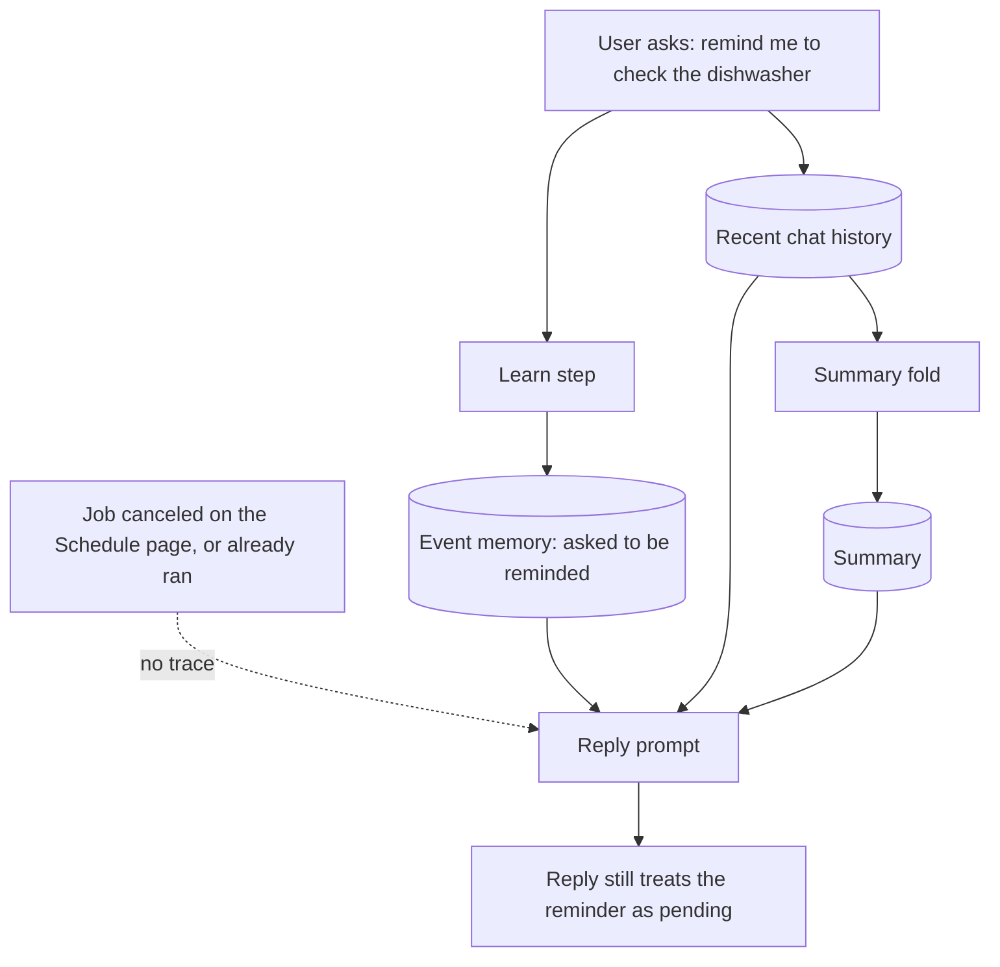
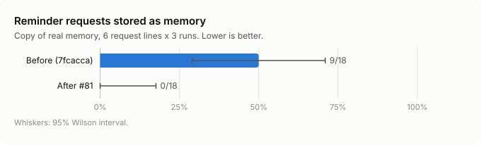
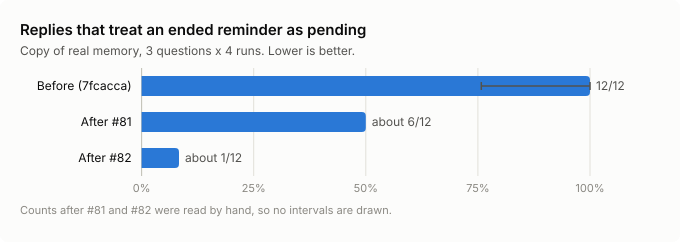

# Stale reminder fix: before and after

A one-off check, run while fixing CetiMind's stale-reminder bug: after a reminder was canceled, replies sometimes still brought it up. It came before the [reminder accuracy](../README.md) benchmark, which replaces it.

The runs used a copy of real CetiMind memory, so no reply text is published here. Only the method and the counts are.

## Cause found

Learn stored each reminder request as an `event` memory, such as "asked to be reminded to check the dishwasher". Recall then ranked those events high on any reminder question, long after the job was gone. The summary fold prompt ("keep names and plans") also kept reminders. Nothing in the prompt said which jobs still existed, and canceling a job on the Schedule page left no trace in the chat.

Each path was closed by one of the two fixes:

| Path | Fix |
| --- | --- |
| Learn stores the request as an event | PR 81: learn skips reminder, timer, and alarm requests |
| Summary keeps it as a plan | PR 81: the fold leaves reminders to the schedule |
| Prompt never says which jobs exist | PR 81: a turn with schedule tools lists the open jobs |
| Chat history still holds "I'll remind you" | PR 82: a cancel writes a note, and the prompt lists reminders that ran or were canceled |

## Setup

- Chat model `qwen3.5-4b`, tool model `nvidia/nemotron-3-nano-4b`, on the same LM Studio endpoint. Settings `chat_thinking` and `tool_thinking` were `auto`.
- Each ref ran in its own process on a scratch data directory with a copied `settings.toml`. The real data directory was not written.
- Code under test:
  - `main` before the fix (`7fcacca`)
  - CetiMind #81 (`4c7c710`, its final branch head): learn skips reminder requests, the summary fold leaves them out, and the prompt lists open jobs
  - CetiMind #82: chat notes for canceled jobs, and a "Reminders that ended" prompt block
- Replies were checked by keyword first, then read by a model. A person did not label them.

## Learn

A fresh copy of the cleaned real memory for each run. Nine lines, 3 runs each. Six were real past reminder requests or similar requests; three were life lines.

| | Before (`7fcacca`) | After #81 |
| --- | --- | --- |
| Reminder requests stored as memory | 9/18 runs (3 of 6 lines, every run) | 0/18 |
| "My smoke alarm went off" stored | 0/3 | 3/3 (event) |
| "Adopted a cat named Mochi" stored | 3/3 as a fact | 3/3 as an event |
| "I wake up at 8am every day" stored | 0/3 (matches an existing fact) | 0/3 (same) |

<picture>
  <source media="(prefers-color-scheme: dark)" srcset="charts/leak-dark.svg">
  
</picture>

The Mochi line moving from fact to event is a kind shift worth watching. The reminder accuracy benchmark tracks it as `kind_correct`.

## Reply

A copy of the real memory taken before stale events were cleaned up, so the old reminder events and the reminder chat lines were still there. Only the daily 8 AM wake-up job was active. Three questions ("Do I have any reminders coming up?", "Is there anything you're supposed to remind me about?", "What should I be keeping an eye on right now?"), 4 runs each.

| Code | Replies that treat an ended reminder as pending |
| --- | --- |
| Before (`7fcacca`) | 12/12 |
| After #81 | about 6/12 |
| After #82, with the cancel note #82 would have written | about 1/12 |

<picture>
  <source media="(prefers-color-scheme: dark)" srcset="charts/stale-dark.svg">
  
</picture>

The one clear miss after #82 came from an old lock-the-door event that was still in this copy. It had already been deleted from the live memory.

What changed in the replies: after #81, direct questions trusted the job list; open-ended questions still trusted the chat history. After #82, replies said the canceled reminder was canceled, or that a fired one had already run.
