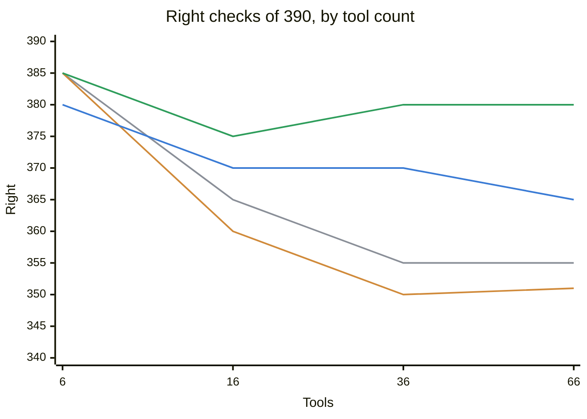
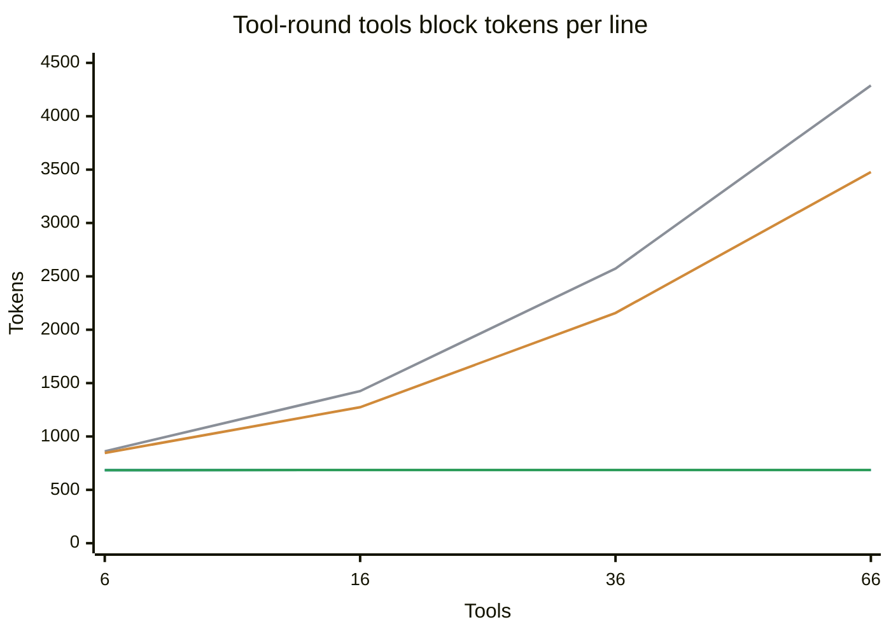

# Narrowing the tool list with keywords

## Question

This run tests narrowing a typed turn's tool list per line. The four core tools (`current_time` and the three schedule tools, the Timer group) always stay, and every other tool joins only when one of its keywords is in the line. The intent check and the tool rounds would then see a shorter list.

Does a keyword-narrowed list keep the tool each line needs? How many prompt tokens does it save? Does the intent check still pick right on the shorter list, including when modules add many more tools?

## Setup

- **Date:** 2026-11-27 and 2026-11-28. The full-turn runs are from 2026-11-28.
- **Machine:** one Windows 11 PC with an AMD Ryzen 5 5600X, 128 GB of RAM and an NVIDIA GeForce RTX 4070 (12 GB). LM Studio and the bench ran on this PC. OBS was running during the expand runs only.
- **Model:** `qwen3.5-4b`, loaded at a 6,144-token context with K/V cache `q8_0`.
- **Call:** CetiMind's `IntentRouter` alone, as in the [intent-check bench](../intent-cancel-example-2026-11-26/README.md): thinking off, temperature 0, the live `INTENT_INSTRUCTION` and intent examples. This matches the live turn when the Tools row isn't On, so the intent check doesn't think.
- **CetiMind:** the intent-check benches call the matcher and keyword lists in [`harness/`](harness/) ([`tool_filter.py`](harness/tool_filter.py), [`tool_keywords.py`](harness/tool_keywords.py)) directly. Those live runs used an unmerged build from 2026-11-27. The offline pass reruns from a CetiMind checkout and gives the same rows as `run-offline/`. The categories and web-core benches import their own pinned copies (`tool_filter.py`, `tool_keywords.py` in [`harness-categories/`](harness-categories/) and [`harness-web-core/`](harness-web-core/)), with the four Timer tools as the core set, so a rerun doesn't depend on CetiMind's own core set; their offline passes give the same rows as `run-categories/` and `run-web-core/`. The first full-turn runs used a checkout with the change in [`harness-turn/turn-wiring.diff`](harness-turn/turn-wiring.diff), which carries the matcher too and applies to CetiMind `main` at `ae5f98f`. CetiMind #159 merged the narrowing, with `web_search` as a core tool, in `3fa16b7`.
- **Model setup not recorded:** the model's quantization and the LM Studio version weren't written down, and no seed went to the server (the seed below only shuffles variant order).
- **Lines:** the 78 intent-bench lines, 39 English and 39 Japanese: the 58 prompt-order cases plus the held-out cancel lines and near misses from `intent_lines.py`. 48 lines need a tool.
- **Repeats:** 5 per line and variant, seed `20261126`, variants shuffled per line.

## Method

### Matching

Each non-core tool has one flat keyword list with no language field ([`harness/tool_keywords.py`](harness/tool_keywords.py)). The line and each keyword are normalized with Unicode NFKC plus `casefold()`, and a keyword matches when it's a substring of the line ([`harness/tool_filter.py`](harness/tool_filter.py)). The keywords were written from each tool's description before the bench lines were read, and weren't tuned on the results. This repo can't prove that order. The bench refuses to run when a keyword is a whole bench line.

### Variants

| Variant | Tools offered |
| --- | --- |
| Full | Every tool, as today |
| Narrow | The four core tools plus keyword matches; the full list when nothing beyond the core tools matches. This is the original fallback design. |
| Strict | The four core tools plus keyword matches, never the full list |
| Expand | Strict, plus a `more_tools` option in the intent check: "Pick this when the user's message needs a tool that is not in this list." Picking it reruns the check on the full list. This is the original expand step. |
| Bare | Full or narrow with every tool's intent examples removed |

### Scaling

The real list has six tools: `current_time`, `schedule_create`, `schedule_list`, `schedule_cancel`, `web_search` and `http_get`. To test longer lists, [`harness/fake_tools.py`](harness/fake_tools.py) adds 10, 30 or 60 fake module tools after the real ones, for 16, 36 or 66 in all. They cover music, smart home, notes, to-do lists, email, calendar and more, each with its own keywords. The intent check reads only a tool's name and description, so the fakes never run. None of them does what a bench line asks, so picking one counts as wrong.

The first scaling run had a fake `water_log` tool, which is a fair pick for "I'm going to drink some water now." The bench scores that line as needing no tool, so the second run swapped `water_log` for `podcast_play` in the same slot ([`harness/fake_tools_run1.py`](harness/fake_tools_run1.py) is the first version). The results below use the second run. Expand ran later, beside its own full and strict runs on the second fake set.

### Scoring

- **Right:** the check's pick matches the line, as in `intent_bench.right()`. A tool line must pick its tool and nothing outside it (the clock aside). A no-tool line must pick nothing. A cancel line must pick `schedule_cancel`.
- **Recall:** every expected tool is in the offered list (no model call).
- **Fallback:** narrow offered the full list because no keyword matched.
- **Extra tools:** offered non-core tools the line doesn't need.
- **Near-miss alarm:** a tool picked on a line that mentions reminders but asks for nothing.
- **Tokens:** LM Studio's `usage.prompt_tokens` with `max_tokens` 1. The intent prompt is counted as sent. The tool-round tools block is the same one-word chat with and without the `tools` field.
- **Tests:** exact two-sided McNemar on paired results against the full list. At temperature 0 every line gave the same answer on all 5 repeats of a run (the one exception is narrow on `lol-ja` at 66 tools, 4 of 5), so the repeats aren't independent. The tables give both counts, but the line-level test is the one to trust. A line counts as right for a variant when most of its repeats were right ([`harness/paired_lines.py`](harness/paired_lines.py) prints the line-level counts). No correction for multiple comparisons was applied; about a dozen tests are in the tables, and none would survive one.

## Results

### Keyword pass, six tools, no model

| Set | Recall (48 tool lines) | Fallback | Extra tools per line | Mean list size |
| --- | --- | --- | --- | --- |
| Full | 48/48 | — | 1.79 | 6.0 |
| Narrow | 48/48 | 63/78 (81%) | 1.63 | 5.8 |
| Strict | 47/48 | 0 | **0.03** | **4.2** |

Strict's one miss is `f1-ja`, 直近のF1レースで勝ったのは誰？ ("Who won the most recent F1 race?"), which matches no Japanese keyword. Narrow falls back on most lines because time and reminder lines match no keyword, and the four core tools are all a turn needs for them.

### Intent check, six tools

| Variant | Right of 390 | Median ms | Intent prompt tokens | Tools block tokens |
| --- | --- | --- | --- | --- |
| Full | 385 | 326 | 280 | 861 |
| Narrow | 385 | 313 | 274 | 845 |
| Strict | 380 | 313 | **215** | 684 |
| Expand | 385 | **311** | 243 | 684 |
| Full, bare | 345 | 323 | — | — |
| Narrow, bare | 345 | 321 | — | — |

Tokens are means per line. Median ms is the median of wall-clock time around each non-streaming call, with no p90 recorded. Bold marks the single highest value in a column; ties aren't bold. Expand's intent prompt and tools block are estimates, not measurements: strict's counts plus 28 tokens for the `more_tools` line (`tokens.json` in the expand runs has only full, narrow and strict).

- **Narrow matched full on every pair.** Strict lost `f1-ja` and `cnew4-ja`, 今日は水のことリマインドしなくていいよ ("No need to remind me about water today"), and won one line. Expand tied full: it also lost `f1-ja`, and got `time-stretch-ja` right where every other variant picked only `schedule_create`.
- **Expand picked `more_tools` 0 times in 390 checks.**
- **The intent examples matter more than the list.** Bare lost 8 lines against live on both lists (0 won, p = 0.008), all of them cancel lines. Live full and narrow meet the bar in `intent_lines.py`: cancel_test 20/20, cancel_new 60/60, near_miss 40/40, tool 155/160.

### Scaling to 66 tools

| Tools | Full | Narrow | Strict | Expand |
| --- | --- | --- | --- | --- |
| 6 | 385 | 385 | 380 | 385 |
| 16 | 365 | 360 | 370 | **375** |
| 36 | 355 | 350 | 370 | **380** |
| 66 | 355 | 351 | 365 | **380** |

Right of 390. Bold marks the single highest value in a row or column; ties aren't bold. Expand at 16 to 66 tools comes from its own run, where full scored 365, 355 and 355 as in the table.

Lines: full (gray), narrow (orange), strict (blue), expand (green). The x-axis is the tool count, evenly spaced, not to scale.





Strict and expand share the same tools block, so their lines overlap in the second chart.

| Tools | Set | Near-miss alarms (checks) | Intent prompt tokens | Tools block tokens | Median ms |
| --- | --- | --- | --- | --- | --- |
| 16 | Full | 10 | 400 | 1,425 | 307 |
| 16 | Strict | 0 | **216** | 686 | 299 |
| 16 | Expand | 0 | 244 | 686 | 292 |
| 36 | Full | 10 | 665 | 2,573 | 344 |
| 36 | Strict | 0 | **216** | 686 | 307 |
| 36 | Expand | 0 | 244 | 686 | 317 |
| 66 | Full | 10 | 1,061 | 4,289 | 364 |
| 66 | Narrow | 10 | 873 | 3,477 | 323 |
| 66 | Strict | 0 | **216** | 686 | 284 |
| 66 | Expand | 0 | 244 | 686 | 340 |

Near-miss alarms count checks. The 10 at each size for the full list are 2 lines, `near3-en` and `near0-ja`, picked on all 5 repeats. Median ms is the median wall-clock time around each non-streaming call, with no p90 recorded, and it varies across runs: strict and full come from the second scaling run and expand from its own run, which OBS overlapped, so compare times only within a run. The full list's median at 66 tools was 332, 364 and 452 ms in three runs (at 36 tools 344 and 371, at 16 tools 306 and 313), so bold isn't used in this column.

Paired against the full list, by line (lines only the variant got right / lines only full got right). Strict's cells are from the second scaling run; its cells in the expand run are 3 / 2, 5 / 3 and 5 / 3 at 16, 36 and 66 tools:

| Tools | Narrow | Strict | Expand |
| --- | --- | --- | --- |
| 6 | 0 / 0 | 1 / 2 | 1 / 1 |
| 16 | 0 / 1 | 3 / 2 | 3 / 1, p 0.63 |
| 36 | 0 / 1 | 5 / 2 | 6 / 1, p 0.13 |
| 66 | 0 / 1 | 5 / 3 | 6 / 1, p 0.13 |

By check, expand against full was 30 / 5 at 36 tools (p < 0.001), but that counts each line five times.

Expand against strict, from the main run (6 tools) and the expand runs (lines only expand got right / lines only strict got right):

| Tools | Expand / strict | p |
| --- | --- | --- |
| 6 | 1 / 0 (`cnew4-ja`) | 1.0 |
| 16 | 1 / 0 (`feel-en`) | 1.0 |
| 36 | 3 / 0 (`feel-en`, `cnew2-ja`, `cnew4-ja`) | 0.25 |
| 66 | 3 / 0 (`feel-en`, `cnew2-ja`, `cnew4-ja`) | 0.25 |

The same few lines carry every size: the expand-over-full lead is `drink-en`, `drink-ja`, `near3-en` and `near0-ja` at 36 and 66 tools, and `near3-en` and `near0-ja` plus `cnew4-en` at 16. The 16, 36 and 66 results use the same 78 lines and the same model, so they aren't three independent confirmations. `more_tools` was picked in 0 of 1,560 expand checks (390 in each of the four expand runs), so the expand path that reruns the full list never ran.

What the full list got wrong at 66 tools, on all 5 repeats:

| Line | Full picked |
| --- | --- |
| `drink-en` "I'm going to drink some water now." | `mood_log` |
| `drink-ja` 今から水を飲むね。 | `mood_log` |
| `feel-ja` 今日の気分はどう？ ("How are you feeling today?") | `mood_log` |
| `near3-en` "I forgot to drink water again, oops." | `habit_log`, `mood_log` |
| `near0-ja` 今日ジムの会員を解約したよ。 ("I canceled my gym membership today.") | `habit_log` |
| `lol-ja` | `joke_tell` |
| `cnew4-ja` 今日は水のことリマインドしなくていいよ。 | `plant_water_log` |

Expand missed only `f1-ja` (no tool; `web_search` is never offered) and `feel-ja` (`mood_log`, offered because 気分 is one of its keywords). Strict missed those two, `feel-en` (`mood_log`, through "feeling"), `cnew4-ja`, and at 66 tools `cnew2-ja`. In these expand runs, it never picked `more_tools` at any size.

By language, at 66 tools: English full 185, strict 190, expand 195 of 195; Japanese full 170, strict 175, expand 185 of 195.

### Full turns (2026-11-28)

The runs above call the intent check alone. To test narrowing in a whole turn, a CetiMind checkout with the change in [`harness-turn/turn-wiring.diff`](harness-turn/turn-wiring.diff) wires it in. The intent check sees the narrowed list, plus `more_tools` when narrowing dropped a tool, and the tool rounds and the miss check get the same list. A tool with no keyword list always stays. CetiMind #159 later merged this wiring with `web_search` as a core tool (`3fa16b7`). These runs predate `web_search` as a core tool: the core set was the four Timer tools, so `web_search` joined only on a keyword.

- **Bench:** CetiMind's turn bench ([`harness-turn/bench.py`](harness-turn/bench.py)), `--profile heavy`, the same 58 heavy-profile lines as the [heavy prompt-order run](../prompt-order-heavy-2026-11-26/README.md) and its scoring. 3 repeats, arms interleaved per line, 348 turns per run. OBS was running.
- **Arms:** `L` is the live turn (thinking-off intent check and replies) with narrowing on. `LWIDE` is the same turn with narrowing off (`narrow_tools=False`), so every tool is sent, as before.
- **Tools:** the six real tools, then the six plus 30 fakes (`--fakes 30`, the second fake set), for 36. A fake tool that gets called answers "Done." and counts as a stray tool. 66 tools wasn't run, because the full list's tool rounds would get close to the 6,144-token context.

| | 6 tools, L | 6 tools, LWIDE | 36 tools, L | 36 tools, LWIDE |
| --- | --- | --- | --- | --- |
| Right tools in the turn | 157/174 (90%) | **163/174 (94%)** | **160/174 (92%)** | 149/174 (86%) |
| Stray tool call | 8/174 | **4/174** | **7/174** | 19/174 |
| Turns that called a fake tool | — | — | **3** | 14 |
| False claims | 0 | 0 | 0 | 0 |
| Partial claims (of 12) | **3** | 7 | 5 | **2** |
| Prompt tokens per turn (mean) | **3,938** | 4,244 | **4,078** | 8,183 |
| First line, median ms (p90) | **998** (1,411) | 1,048 (1,765) | **952** (1,444) | 959 (1,341) |
| Done, median ms (p90) | 5,349 (7,972) | **5,287** (7,206) | 5,346 (8,012) | **5,281** (8,084) |

Bold marks the preferred value of each pair (higher accuracy, lower counts, lower times); ties aren't bold. Times are medians of wall-clock time around non-streaming calls, in ms, with the p90 in brackets. First line is the time to the first spoken line (the hold line or the reply), not time to first token. Full tables, with Wilson 95% intervals and times per step: [`run-turn-6/summary.md`](run-turn-6/summary.md) and [`run-turn-36/summary.md`](run-turn-36/summary.md).

Paired against `LWIDE` (only L right / only LWIDE right, exact McNemar). By line, a line counts as right for an arm when most of its 3 repeats were right, as in the rest of this write-up:

| Tools | By turn | By line |
| --- | --- | --- |
| 6 | 3 / 9, p 0.15 | 0 / 3, p 0.25 |
| 36 | 17 / 6, p 0.035 | 6 / 2, p 0.29 |

- **At six tools the two are about level.** By line only `LWIDE` wins any: `f1-ja` (0/3 against 3/3, the keyword miss, which the later web-core run addresses), `time-stretch-en` (0/3 against 2/3) and `time-stretch-ja` (1/3 against 2/3). On the `time-stretch` lines the intent check still picked `current_time` and `schedule_create`, but the tool rounds saw the 4 Timer tools against 6, because `web_search` and `http_get` were dropped, and with narrowing they called only one of the two on most repeats. The needed tools were there; the shorter list still changed the rounds. Narrowing saves about 300 prompt tokens per turn.
- **At 36 tools narrowing is ahead on tool picks and prompt size,** significantly by turn but not by line (6 lines to 2: it wins `drink-en`, `drink-ja`, `forget-ja`, `godot-try-ja`, `time-ja` and `wake-ja`, and loses `f1-ja` and `time-stretch-ja`). It isn't ahead on every measure: partial claims were 5 of 12 against 2, and the miss check helps the full list more (see below). With every tool sent, the tool rounds called fake tools on 14 turns: `mood_log` 6 times, `lights_set` 5 times (on reminder lines, beside or instead of `schedule_create` and `schedule_cancel`), `habit_log` twice and `note_list` once. The check had often picked the right tool; the round then called a near-topic one. With narrowing, the rounds never see those tools, and its 3 fake calls were all `mood_log` on `feel-ja`, where the 気分 keyword puts it in the list. By language the gap is all Japanese: 77 against 67 of 87, with English 83 against 82.
- **Narrowing halves the prompt at 36 tools** (4,078 against 8,183 tokens per turn). First-line and done medians stay within 100 ms of each other (952 (1,444) against 959 (1,341) first line; 5,346 (8,012) against 5,281 (8,084) done).
- **`more_tools` was never picked in a full turn:** no turn in either full-turn run made a second intent call.
- **After the miss check the gap shrinks** at 36 tools (156 against 150 of 174). The miss check works on the narrowed list too, and it added a late tool on 4 Japanese no-tool turns (`day-ja` twice, `ramen-ja`, `drink-ja`). Those late calls are in `steps.jsonl` (post-miss `task_round` rows) and `net_fired` is true, but the turn's `ran` field stays empty, so count late tools from `steps.jsonl`.

### Categories instead of more_tools (2026-11-28)

In the earlier expand runs, `more_tools` never fired, so a later run tested a more concrete prompt for the expand step. The `cat` variant offers strict narrowing plus one line for each category whose tools narrowing dropped, such as "web: Search the web and read web pages: news, prices, weather, scores, and anything live or at a URL." Picking a category reruns the check with that category's tools added. The 60 fake tools were grouped into 10 categories by domain before the run ([`harness-categories/fake_tools.py`](harness-categories/fake_tools.py), `FAKE_CATEGORIES`), and the two web tools form an 11th. The four core tools are never a category.

Full, strict, expand and categories ran interleaved on the 78 intent lines, 5 repeats, on the second fake set, at 16, 36 and 66 tools ([`harness-categories/tool_keyword_bench.py`](harness-categories/tool_keyword_bench.py)). Intent tokens are the app's estimate of the first check's tool lines.

| Tools | Variant | Right of 390 | Near-miss alarms | Second checks | Intent tokens (est.) | Median ms |
| --- | --- | --- | --- | --- | --- | --- |
| 16 | Full | 370 | 10 | 0 | 329 | 310 |
| 16 | Strict | 370 | **0** | 0 | **153** | **276** |
| 16 | Expand | **375** | **0** | 0 | 182 | 283 |
| 16 | Categories | 370 | 10 | 15 | 435 | 336 |
| 36 | Full | 355 | 10 | 0 | 581 | 341 |
| 36 | Strict | 365 | **0** | 0 | **153** | **276** |
| 36 | Expand | **380** | **0** | 0 | 182 | 287 |
| 36 | Categories | 365 | 10 | 30 | 512 | 341 |
| 66 | Full | 355 | 10 | 0 | 974 | 376 |
| 66 | Strict | 365 | **0** | 0 | **153** | **271** |
| 66 | Expand | **380** | **0** | 0 | 182 | 280 |
| 66 | Categories | 370 | 10 | 30 | 547 | 333 |

Bold marks the highest value at each size, counting a tie for highest as highest (for alarms, checks, tokens and times, the lowest). The full, strict and expand counts match the earlier runs at 36 and 66 tools.

Paired by line (lines only the first right / only the second right, exact McNemar):

| Tools | Categories vs full | Categories vs strict | Categories vs expand |
| --- | --- | --- | --- |
| 16 | 0 / 0 | 2 / 2 | 1 / 2, p 1.0 |
| 36 | 3 / 1, p 0.63 | 2 / 2 | 1 / 4, p 0.38 |
| 66 | 3 / 0, p 0.25 | 3 / 2, p 1.0 | 1 / 3, p 0.63 |

- **The web category reached the keyword miss.** The check picked `category_web` on `f1-ja` on every repeat at every size, then picked `web_search`. No other narrowed variant gets that line.
- **The wellness category brought the near-topic picks back.** `category_wellness` was picked on 2 lines, `near0-ja` (the gym-cancel line) and `near3-en` ("I forgot to drink water again"), on all 5 repeats at each size, and the second check then picked `habit_log` or `mood_log`. That's the same 2 lines and 10 near-miss alarm checks at every size as the full list.
- **Other categories cost a second check and changed nothing.** `category_home` at 36 tools and `category_calendar` at 66 were each picked on 2 lines on all 5 repeats, with a right answer each time. 15 to 30 of 390 checks ran the check twice: 3 lines at 16 tools and 6 at 36 and 66.
- **Categories cost more than expand.** The category lines take two to three times expand's intent tokens, and at 16 tools more than the full list. The median check is about 50 ms slower than expand's.
- **Expand still scored highest at every size,** though by line its lead over categories isn't significant.

### Web search as a core tool (2026-11-28)

Every narrowed variant above loses `f1-ja` because no web keyword matches, and the bench had only one such line. This run added 20 held-out lines, written before it ([`harness-web-core/holdout_lines.py`](harness-web-core/holdout_lines.py)):
- **12 web questions** that need `web_search` but avoid the web keywords, such as "Has the typhoon reached Okinawa?" and 台風はもう沖縄に来た？
- **8 small-talk lines** close to a category's topic, such as "I slept so badly last night." or "I love that song you mentioned."

It compares five lists, interleaved, 5 repeats, on the 78 bench lines plus the 20 held-out lines ([`harness-web-core/tool_keyword_bench.py`](harness-web-core/tool_keyword_bench.py)):

| Variant | First list |
| --- | --- |
| Full | Every tool |
| Expand | The four core tools, keyword matches and `more_tools` |
| Web core + expand | Expand with `web_search` always in the list |
| Keyword categories | Expand plus a line for each category whose broad keywords match (picking one reruns the check with its tools) |
| Web core + keyword categories | Keyword categories with `web_search` always in the list; a category with a tool already listed gets no line |

The category keywords are in `CATEGORY_KEYWORDS` (`fake_tools.py`) and `REAL_CATEGORY_KEYWORDS` (the bench). The web category's keywords are time words such as "today", "this week", 昨夜 and 最新. They were written after the held-out lines, so some overlap them, and they also match `f1-ja`. A run of keyword categories without web core started before this one and was stopped and discarded.

| Tools | Variant | Bench lines (of 390) | Held-out web (of 60) | Held-out small talk (of 40) | Near-miss alarms | Second checks | Intent tokens (est.) | Median ms |
| --- | --- | --- | --- | --- | --- | --- | --- | --- |
| 16 | Full | 365 | **60** | 15 | 10 | 0 | 329 | 287 |
| 16 | Expand | 375 | 5 | 35 | **0** | 5 | **181** | **250** |
| 16 | Web core + expand | 380 | **60** | 35 | **0** | 0 | 213 | 276 |
| 16 | Keyword categories | **385** | 30 | **40** | **0** | 50 | 196 | 268 |
| 16 | Web core + keyword categories | 380 | **60** | **40** | **0** | 10 | 215 | 280 |
| 36 | Full | 355 | 55 | 15 | 10 | 0 | 581 | 326 |
| 36 | Expand | 380 | 10 | **25** | **0** | 15 | **181** | **261** |
| 36 | Web core + expand | 380 | **60** | **25** | **0** | 0 | 214 | 287 |
| 36 | Keyword categories | **385** | 30 | **25** | **0** | 50 | 198 | 278 |
| 36 | Web core + keyword categories | 380 | **60** | **25** | **0** | 0 | 215 | 294 |
| 66 | Full | 360 | 55 | 10 | 10 | 0 | 974 | 369 |
| 66 | Expand | 375 | 10 | **25** | **0** | 15 | **181** | **250** |
| 66 | Web core + expand | 380 | **60** | **25** | **0** | 0 | 214 | 287 |
| 66 | Keyword categories | **385** | 30 | **25** | **0** | 50 | 198 | 270 |
| 66 | Web core + keyword categories | 380 | **60** | **25** | **0** | 0 | 215 | 284 |

Bold marks the highest value at each size, counting a tie for highest as highest (for alarms, checks, tokens and times, the lowest).

Against expand, by line (lines only this variant got right more often / lines only expand did, exact McNemar):

| Tools | Full | Web core + expand | Keyword categories | Web core + keyword categories |
| --- | --- | --- | --- | --- |
| 16 | 12 / 7, p 0.36 | **12 / 0, p < 0.001** | 8 / 0, p 0.008 | **13 / 0, p < 0.001** |
| 36 | 10 / 8, p 0.81 | **11 / 1, p 0.006** | 5 / 0, p 0.06 | **11 / 1, p 0.006** |
| 66 | 10 / 7, p 0.63 | **11 / 0, p 0.001** | 6 / 0, p 0.03 | **11 / 0, p 0.001** |

- **Making `web_search` a core tool had the strongest held-out web result.** Both web-core variants got every held-out web check at every size, against 5 to 10 of 60 for expand, and the line-level lead over expand was significant at every size (12 / 0, p < 0.001 at 16 tools; 11 / 1, p = 0.006 at 36; 11 / 0, p = 0.001 at 66). The cost is about 33 intent tokens and 25 to 35 ms on the median check. No small-talk line picked `web_search`, and no web-core variant had a near-miss alarm.
- **Keyword categories add little once web search is core.** At 36 and 66 tools the two web-core variants scored the same, with no second checks, since no other category keyword matched these lines. At 16 tools the categories got one small-talk line right, もっと母に電話しなきゃな ("I should really call my mom more"), where expand and web core + expand picked `schedule_create`.
- **Keyword categories alone** scored highest on the bench lines (385 at every size) and reached `f1-ja`, but reached only the 6 held-out web lines whose words list the web category. They also asked for a second check 50 times per size.
- **Some misses no fallback reaches.** At 36 and 66 tools every narrowed variant lost the same small-talk lines, because tool keywords over-match: "call" adds `call_start` and "plant" adds `plant_water_log`, and the model picks them. `feel-ja` (`mood_log` through 気分) and `cnew4-ja` stay wrong too. Word-edge matching for short Latin keywords is the likely change for the first kind.
- **`more_tools` fired in this run, for the first time.** Expand's second check ran on 1 held-out web line at 16 tools (`hold-web1-ja`, all 5 repeats) and on 3 at 36 and 66 tools. It got `web_search` on `hold-web1-ja` and, at 36 and 66, `hold-web4-en`, which are all of expand's held-out web hits. On `hold-web2-ja` it fired and the second check still picked nothing. So the catch-all reached 1 of 12 held-out web lines at 16 tools and 2 of 12 at 36 and 66. These are small counts, with no test.
- **Expand scored 375 at 66 tools here,** against 380 in the categories run, with no prompt change.
- **The held-out web lines are a dev set now.** They were used to choose web core, so 60 of 60 shows the choice works on them, not that it generalises. The fresh run below tests that.

### Fresh held-out lines (2026-11-28)

The first held-out set chose web core, so it can't test it. A second set was written after that choice, with the same rules ([`harness-web-core/holdout_lines_2.py`](harness-web-core/holdout_lines_2.py)):
- **24 web questions** that need `web_search` and match no web keyword, such as "Is the Tokaido Shinkansen delayed right now?" and 京都の桜はもう咲いてる？
- **16 small-talk lines** near a web or category topic that ask for nothing, such as "I watched the match with friends, it was great." and "I think I'm getting a cold."

The same author wrote the keyword lists, so knew the web keywords while writing these lines. Two lines match a fake tool's keyword ("launch" for `app_open`, "game" for `game_start`), and they were kept. Full, expand and web core + expand ran interleaved on these 40 lines alone (`--fresh --only-holdout`), 5 repeats, with the pinned matcher in `harness-web-core/`.

| Tools | Variant | Web (of 120) | Small talk (of 80) | Small talk that picked `web_search` | Second checks | Intent tokens (est.) | Median ms |
| --- | --- | --- | --- | --- | --- | --- | --- |
| 16 | Full | **120** | 25 | **0** | 0 | 329 | 380 |
| 16 | Expand | 15 | **80** | **0** | 15 | **174** | **354** |
| 16 | Web core + expand | **120** | 60 | 20 | 0 | 211 | 410 |
| 36 | Full | **120** | 30 | **0** | 0 | 581 | 357 |
| 36 | Expand | 16 | **80** | **0** | 16 | **175** | **291** |
| 36 | Web core + expand | **120** | 74 | 6 | 0 | 212 | 359 |
| 66 | Full | 115 | 50 | **0** | 0 | 974 | 412 |
| 66 | Expand | 15 | **80** | **0** | 15 | **175** | **294** |
| 66 | Web core + expand | **120** | 70 | 10 | 0 | 212 | 366 |

Bold marks the highest value at each size, counting a tie for highest as highest (for strays, tokens and times, the lowest). By line, majority of 5 (lines only the first right / only the second right, exact McNemar):

| Tools | Web core + expand vs expand | Web core + expand vs full | Full vs expand |
| --- | --- | --- | --- |
| 16 | 21 / 4, p < 0.001 | 8 / 1, p 0.039 | 21 / 11, p 0.11 |
| 36 | 21 / 1, p < 0.001 | 9 / 0, p 0.004 | 21 / 10, p 0.071 |
| 66 | 21 / 2, p < 0.001 | 6 / 1, p 0.13 | 20 / 6, p 0.009 |

- **Web core holds on lines it wasn't chosen on.** It got all 120 fresh web checks at every size. Expand got 3 of 24 lines, all through `more_tools`, which it picked on 3 or 4 lines per size.
- **Web core costs some small talk.** Two lines picked `web_search`: "I think I'm getting a cold." on all 5 repeats at every size, and "I'm so tired of trains being late." on 5, 1 and 5 repeats at 16, 36 and 66 tools. At 16 tools both Japanese versions did too. That's 2 to 4 of 16 lines, against none for expand or the full list. The first held-out set had no such pick, so the earlier "no small-talk line picked `web_search`" holds only for that set.
- **The full list's small-talk misses are near-topic fake tools,** mostly `mood_log` and `habit_log`, on 6 to 11 lines per size. Web core + expand beat it by line at 16 and 36 tools.
- Web core adds about 37 intent tokens over expand here.

### Full turns with web core (2026-11-28)

The full-turn runs were repeated on CetiMind #159 as it is ([`harness-turn-web-core/narrowing-web-core.diff`](harness-turn-web-core/narrowing-web-core.diff)): `web_search` core, the new `more_tools` wording, and the turn bench from that tree ([`harness-turn-web-core/bench.py`](harness-turn-web-core/bench.py)). Same lines, arms, repeats, profile and fake set as the first full-turn runs. OBS was not running.

| | 6 tools, L | 6 tools, LWIDE | 36 tools, L | 36 tools, LWIDE |
| --- | --- | --- | --- | --- |
| Right tools in the turn | **165/174 (95%)** | 164/174 (94%) | **162/174 (93%)** | 152/174 (87%) |
| After the miss check | **164/174** | 161/174 | **161/174** | 154/174 |
| Stray tool call | **4/174** | 7/174 | **9/174** | 16/174 |
| Turns that called a fake tool | — | — | **3** | 12 |
| Stray `web_search` call in a tool round | **1** | 3 | 2 | **0** |
| False claims | 0 | 0 | 0 | 0 |
| Partial claims (of 12) | 2 | 2 | **2** | 3 |
| Prompt tokens per turn (mean) | **4,205** | 4,395 | **4,317** | 8,080 |
| First line, median ms (p90) | **980** (1,538) | 999 (1,549) | 880 (1,338) | **874** (1,201) |
| Done, median ms (p90) | 4,997 (7,291) | **4,962** (8,273) | 4,748 (7,149) | **4,624** (6,293) |

Bold marks the preferred value of each pair; ties aren't bold. Stray `web_search` counts turns on lines that don't need it where a tool round called it, including calls after the miss check ([`harness-turn/web_strays.py`](harness-turn/web_strays.py), `web-strays.txt` in each run folder). Full tables: [`run-turn-web-core-6/summary.md`](run-turn-web-core-6/summary.md) and [`run-turn-web-core-36/summary.md`](run-turn-web-core-36/summary.md).

| Tools | By turn | By line |
| --- | --- | --- |
| 6 | 6 / 5, p 1.0 | 2 / 2, p 1.0 |
| 36 | 14 / 4, p 0.031 | 4 / 0, p 0.13 |

- **At six tools the two are now level** (165 against 164). `f1-ja` is right on all 3 repeats in both arms, where narrowing missed it before. Each arm wins 2 lines by majority: narrowing `forget-ja` and `godot-try-en`, every tool `still-ja` and `time-stretch-en`.
- **At 36 tools narrowing is ahead again** (162 against 152), significantly by turn but not by line. It wins `drink-en`, `drink-ja`, `forget-ja` and `time-ja` by majority and loses none. With every tool sent, the tool rounds called a fake tool on 12 turns (`habit_log`, `lights_set` and `mood_log` 3 each, then `calculator`, `note_list` and `todo_done`). Narrowing's 3 were `mood_log` on `feel-ja` again.
- **Stray `web_search` in tool rounds is rare in both arms.** The intent check never routed `web_search` to a line that doesn't need it. With narrowing, a tool round called it on 3 of 288 such turns, all Japanese reminder lines (`still-ja`, `cancel-ja`, `forget-ja`), beside the schedule tools. With every tool sent it was 3 of 288 (`ramen-ja` twice, `forget-ja`). Before web core these counts were 1 and 1.
- **Narrowing still halves the prompt at 36 tools** (4,317 against 8,080 tokens per turn), and medians stay within 130 ms of each other.

## Reading

- **Narrow as first sketched isn't worth building.** It keeps every tool, but it falls back to the full list on 81% of lines, so it saves 2% of the tools block at six tools and 19% at 66. It never beat the full list.
- **Strict and expand keep the list small however many tools exist.** The tools block stays at about 686 tokens, against 4,289 for the full list at 66 tools (84% less), and the intent prompt at 216 to 244 tokens against 1,061. Treat 686 as a best-case floor: it's the four core tools alone, because no bench line needs a fake tool and the fake keywords fire on only 3 lines. A real module set would add tools whenever its keywords match.
- **A longer full list makes the check pick near-topic module tools.** From 16 tools on, the full list picked `mood_log`, `habit_log` and similar tools on small-talk lines, with 2 near-miss lines picked on all 5 repeats at every size. Length itself wasn't the problem: the full list scored the same at 36 and 66 tools. The tools that sit close to a line's topic are. The labels matter here: the bench scores any fake-tool pick as wrong, though `mood_log` on "How are you feeling today?" is arguably a fair pick for a real module.
- **Expand had the highest score from 16 tools on in the first scaling runs, but not because it rescued anything there.** In those runs the model never picked `more_tools`, so expand is strict plus one extra line in the intent prompt, and that lead can't come from the expand step. By line the lead over the full list is 6 to 1 at 36 and 66 tools (p = 0.13, not significant), and the same few lines carry every size. Against strict it's 3 to 0 (p = 0.25), on `feel-en`, `cnew2-ja` and `cnew4-ja`, and `cnew2-ja` is a line that flipped for strict between two runs with no prompt change. With no control arm that adds a dummy line, this run can't separate the `more_tools` option from any other change to the prompt.
- **Keywords miss paraphrases, and can also add harm.** `f1-ja` never gets `web_search` in strict or expand, and the expand step didn't catch it on this model. "feeling" and 気分 put `mood_log` in the list on the feel lines, and the model picks it.
- **The full-turn runs agree.** At six tools narrowing and the full list are about level (by line 0 to 3, p = 0.25, mostly the `f1-ja` keyword miss and `time-stretch` tool-round misses). At 36 tools the full list's tool rounds call near-topic fake tools, and narrowing scores higher on tool picks with half the prompt tokens, and first-line and done medians within 100 ms of each other (17 turns to 6, p = 0.035; by line 6 to 2, p = 0.29, not significant).
- **Categories didn't beat expand.** Concrete category lines reached the keyword miss on `f1-ja`, but a wellness category pulled small-talk lines into near-topic tools, and they cost two to three times expand's intent tokens. Category descriptions would need the same care as tool descriptions, and this run tuned none of them.
- **Web search belongs in the core set.** Making `web_search` core got every held-out web check at 16, 36, and 66 tools, on the first set and on a fresh one written after the choice, with a significant line-level lead over expand at every size, and added no near-miss alarms, for about 33 to 37 intent tokens. Keyword categories added little on top. The cost is some small talk: on the fresh set, 2 to 4 of 16 small-talk lines picked `web_search` in the intent check alone, where expand picked nothing.
- **In full turns web core removes narrowing's six-tool loss and keeps its 36-tool lead.** Narrowing scored 165 against 164 at 6 tools and 162 against 152 at 36 (14 turns to 4, p = 0.031; by line 4 to 0, p = 0.13, not significant). Tool rounds called `web_search` on a line that doesn't need it on 3 of 288 such turns, as often as with every tool sent.
- **Recommendation:** strict narrowing is the supported choice, with `web_search` as a core tool beside the other core tools and `more_tools` as the catch-all. Watch for `web_search` on small talk about live topics (illness, delays): the intent check alone picked it on a few fresh lines, though full turns showed no rise in stray calls. Expand's lead over strict still isn't significant. `more_tools` was never picked in the earlier expand runs or the full-turn runs; in the web-core run it fired and the second check got `web_search` on 1 of 12 held-out web lines at 16 tools and on 2 of 12 at 36 and 66 tools, so it remains a rarely used fallback, not a proven one. Keep the core tools first in the list and add matches after them, so the start of the prompt stays the same. Test a real fallback for keyword misses next, such as a group-widening second pass, and a control arm that adds a dummy line.

## Limits

- One model, one machine. The bench lines are synthetic, the Japanese lines are machine-translated, and only 48 of the 78 lines need a tool.
- Two languages only, English and Japanese. No third language, accented line or other CJK language is in the bench, so the language-agnostic claim is tested on two.
- The outing tools have keywords in `harness/tool_keywords.py` but aren't offered or tested here, so their recall is untested.
- The fake tools are invented, and their keywords fire on only 3 bench lines, all small talk. No bench line needs a fake tool, so this doesn't test recall for module tools.
- The gaps rest on a handful of lines. More distinct lines would firm them up more than more repeats.
- `cnew2-ja` flipped for strict between two runs with no prompt change (right in the second scaling run, wrong in the expand run). It's likely LM Studio's prompt cache with the `q8_0` K/V cache.
- A list that changes per line breaks the prompt cache at the tools block. This run counted tokens, not cache hits or time to first token.
- The scaling and expand runs call the intent check alone. The full-turn runs cover 6 and 36 tools on the heavy profile only, with 3 repeats.
- The first full-turn runs predate `web_search` as a core tool. That is why `f1-ja` is a 0/3 miss for `L` at both sizes, and why those runs don't test the core set CetiMind ships.
- The fresh held-out lines were written by the author of the keyword lists, who knew the web keywords. 40 lines is still a small set.
- The first held-out web lines were written before the web-core run, but the web category's keywords were written after them (see the web-core section), and the lines were then used to choose web core.
- In both full-turn runs every intent and miss step logs `tools_offered: 0`, so the raw steps can't show whether `more_tools` was in the intent list. No turn made a second intent call, which is what the `more_tools` claims rest on.
- **Timing:** wall clock around non-streaming calls, so the medians include the client, with no time to first token and no p90. The full list's median at 66 tools was 332, 364 and 452 ms in three runs, so run-to-run spread for the same setup can top 100 ms, larger than most gaps between variants. Compare times only within a run.
- **Temperature 0 isn't fully deterministic here.** Narrow on `lol-ja` at 66 tools offered the same 66 tools as the full list and still gave one different answer in 5.

## Files

- [`harness/`](harness/): `tool_keyword_bench.py` (the bench), `fake_tools.py` (second fake set) and `fake_tools_run1.py` (first, with `water_log`), `tool_filter.py` and `tool_keywords.py` (the matcher and keyword lists the bench imports), `paired_lines.py` (line-level counts from `calls.jsonl`), and the line sets `intent_bench.py`, `intent_lines.py`, `heavy.py`, `lines.py`.
- `run-offline/`: the keyword pass with no model (`offline.jsonl`, one row per line).
- `run-main/`: six tools, all six variants. `calls.jsonl` has one row per check, `tokens.json` the server counts, `summary.json` the tables.
- `run-scale-1/tools-16|36|66/`: the first scaling run, with `water_log`.
- `run-scale-2/tools-16|36|66/`: the second scaling run, full, narrow and strict.
- `run-expand/tools-16|36|66/`: full, strict and expand on the second fake set.
- `run-turn-6/` and `run-turn-36/`: the full-turn runs. `turns.jsonl` has one row per turn, `steps.jsonl` one row per model call, `summary.md` the tables from `summarize.py`.
- `run-categories/tools-16|36|66/`: full, strict, expand and categories, with `calls.jsonl` rows that name the categories picked and the second check's list.
- `run-web-core/tools-16|36|66/`: the web-core run, five variants, with the held-out lines. `run-web-core/*.json` are the tables from `summarize_web_core.py`.
- `run-fresh/tools-16|36|66/`: full, expand and web core + expand on the fresh held-out lines. `run-fresh/summary.json` is the table from `summarize_fresh.py`.
- `run-turn-web-core-6/` and `run-turn-web-core-36/`: the full-turn runs on CetiMind #159 with web core. `web-strays.txt` in each full-turn run folder is the stray `web_search` count from `web_strays.py`.
- [`harness-web-core/`](harness-web-core/): the bench with the `webexp`, `catkw` and `webcat` variants, `--holdout`, `--fresh` and `--only-holdout`, `fake_tools.py` with `CATEGORY_KEYWORDS`, `holdout_lines.py` (the first held-out set), `holdout_lines_2.py` (the fresh set), `tool_filter.py` and `tool_keywords.py` (the pinned matcher, with the four Timer tools as core and the `more_tools` text these runs used), `summarize_web_core.py` and `summarize_fresh.py`.
- [`harness-categories/`](harness-categories/): the bench with the `cat` variant, the fake tools with `FAKE_CATEGORIES`, and the same pinned `tool_filter.py` and `tool_keywords.py`.
- [`harness-turn/`](harness-turn/): the turn bench (`bench.py` with the `LWIDE` arm and `--fakes`, `heavy.py`, `lines.py`, `long_results.py`, `summarize.py`), `fake_tools.py`, and `turn-wiring.diff`, the change to CetiMind's `src/` these runs used: the matcher (`core/tool_filter.py`, no full-list fallback, tools with no keywords stay), the keyword lists and the turn wiring. `summarize.py` pairs `L` against `LWIDE`, by turn and by line, and `web_strays.py` counts stray `web_search` calls.
- [`harness-turn-web-core/`](harness-turn-web-core/): `bench.py` from the #159 tree (it reads the model profiles merged into CetiMind `main` in #158), and `narrowing-web-core.diff`, the change to CetiMind's `src/` those runs used.

To run it again, copy the files in `harness/` into `bench/prompt_order/` of a CetiMind checkout. The bench imports the matcher and keyword lists from the copies in `harness/`, and the rest from CetiMind. The offline pass needs no model. Then:

```bash
uv run python bench/prompt_order/tool_keyword_bench.py --out run-offline
uv run python bench/prompt_order/tool_keyword_bench.py --base-url http://HOST:PORT/v1 --out run-main --repeats 5
uv run python bench/prompt_order/tool_keyword_bench.py --base-url http://HOST:PORT/v1 --out run-scale-2/tools-66 --fakes 60 --variants full_live,narrow_live,strict_live --repeats 5
uv run python bench/prompt_order/tool_keyword_bench.py --base-url http://HOST:PORT/v1 --out run-expand/tools-66 --fakes 60 --variants full_live,strict_live,expand_live --repeats 5
```

Use `--fakes 10` and `--fakes 30` for the 16- and 36-tool sizes.

The categories run uses the files in `harness-categories/`, copied over `harness/`:

```bash
uv run python bench/prompt_order/tool_keyword_bench.py --base-url http://HOST:PORT/v1 --out run-categories/tools-66 --fakes 60 --variants full_live,strict_live,expand_live,cat_live --repeats 5
```

The web-core run uses the files in `harness-web-core/`, copied over `harness/`:

```bash
uv run python bench/prompt_order/tool_keyword_bench.py --base-url http://HOST:PORT/v1 --out run-web-core/tools-66 --fakes 60 --holdout --variants full_live,expand_live,webexp_live,catkw_live,webcat_live --repeats 5
python harness-web-core/summarize_web_core.py .
```

The fresh run uses the same files:

```bash
uv run python bench/prompt_order/tool_keyword_bench.py --base-url http://HOST:PORT/v1 --out run-fresh/tools-66 --fakes 60 --fresh --only-holdout --variants full_live,expand_live,webexp_live --repeats 5
python harness-web-core/summarize_fresh.py .
```

The first full-turn runs need CetiMind `main` at `ae5f98f` with `harness-turn/turn-wiring.diff` applied (`git apply`), and the files in `harness-turn/`:

```bash
uv run python bench/prompt_order/bench.py --base-url http://HOST:PORT/v1 --out run-turn-36 --profile heavy --arms L,LWIDE --repeats 3 --fakes 30
uv run python bench/prompt_order/summarize.py run-turn-36
```

The full turns with web core need CetiMind `main` at `3fa16b7` (the #159 merge), or at `a681511` with `harness-turn-web-core/narrowing-web-core.diff` applied, the files in `harness-turn/`, and `harness-turn-web-core/bench.py` over them:

```bash
uv run python bench/prompt_order/bench.py --base-url http://HOST:PORT/v1 --out run-turn-web-core-36 --profile heavy --arms L,LWIDE --repeats 3 --fakes 30
uv run python bench/prompt_order/summarize.py run-turn-web-core-36
python harness-turn/web_strays.py run-turn-web-core-36
```
