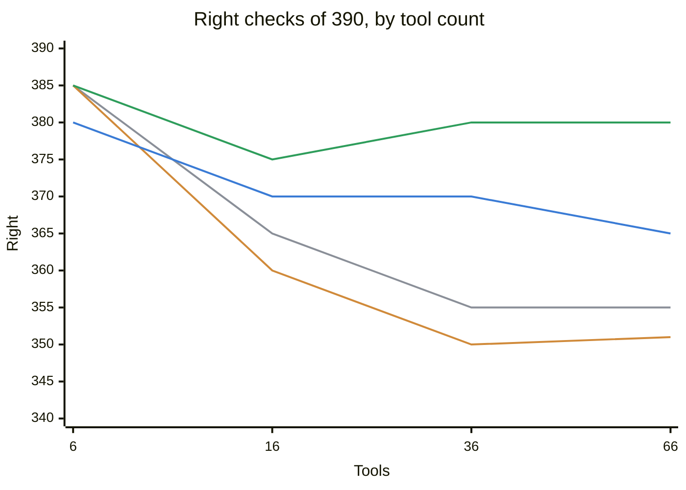
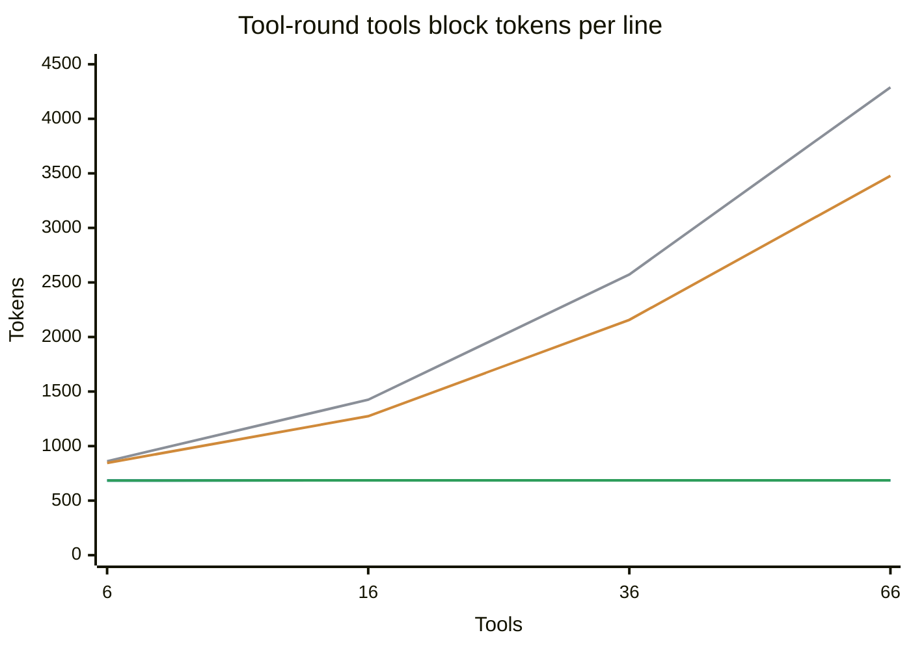

# Narrowing the tool list with keywords

## Question

[CetiMind #154](https://github.com/miramocha/CetiMind/issues/154) proposes narrowing a typed turn's tool list per line. The four Timer tools always stay, and every other tool joins only when one of its keywords is in the line. The intent check and the tool rounds would then see a shorter list.

Does a keyword-narrowed list keep the tool each line needs? How many prompt tokens does it save? Does the intent check still pick right on the shorter list, including when modules add many more tools?

## Setup

- **Date:** 2026-11-27 and 2026-11-28.
- **Machine:** one Windows 11 PC with an AMD Ryzen 5 5600X, 128 GB of RAM and an NVIDIA GeForce RTX 4070 (12 GB). LM Studio and the bench ran on this PC. OBS was running during the expand runs only.
- **Model:** `qwen3.5-4b`, loaded at a 6,144-token context with K/V cache `q8_0`.
- **Call:** CetiMind's `IntentRouter` alone, as in the [intent-check bench](../intent-cancel-example-2026-11-26/README.md): thinking off, temperature 0, the live `INTENT_INSTRUCTION` and intent examples. This matches the live turn when the Tools thinking row is not On.
- **CetiMind:** a local branch with the keyword matcher and this bench (commits `f9726e8`, `282f39b`, `9ceae4a`, part of #154, not yet merged). The matcher is not wired into turns yet; the bench calls it directly. A copy of the harness is in [`harness/`](harness/).
- **Lines:** the 78 intent-bench lines, 39 English and 39 Japanese: the 58 prompt-order cases plus the held-out cancel lines and near misses from `intent_lines.py`. 48 lines need a tool.
- **Repeats:** 5 per line and variant, seed `20261126`, variants shuffled per line.

## Method

### Matching

Each non-core tool has one flat keyword list with no language field ([`harness/tool_keywords.py`](harness/tool_keywords.py)). The line and each keyword are normalized with Unicode NFKC plus `casefold()`, and a keyword matches when it is a substring of the line ([`harness/tool_filter.py`](harness/tool_filter.py)). The keywords were written from each tool's description before the bench lines were read, and were not tuned on the results. The bench refuses to run when a keyword is a whole bench line.

### Variants

| Variant | Tools offered |
| --- | --- |
| Full | Every tool, as today |
| Narrow | The four Timer tools plus keyword matches; the full list when nothing beyond the Timer tools matches. This is the issue's sketch. |
| Strict | The four Timer tools plus keyword matches, never the full list |
| Expand | Strict, plus a `more_tools` option in the intent check: "Pick this when the user's message needs a tool that is not in this list." Picking it reruns the check on the full list. This is the issue's expand step. |
| Bare | Full or narrow with every tool's intent examples removed |

### Scaling

The real list has six tools: `current_time`, `schedule_create`, `schedule_list`, `schedule_cancel`, `web_search` and `http_get`. To test longer lists, [`harness/fake_tools.py`](harness/fake_tools.py) adds 10, 30 or 60 fake module tools after the real ones, for 16, 36 or 66 in all. They cover music, smart home, notes, to-do lists, email, calendar and more, each with its own keywords. The intent check reads only a tool's name and description, so the fakes never run. None of them does what a bench line asks, so picking one counts as wrong.

The first scaling run had a fake `water_log` tool, which is a fair pick for "I'm going to drink some water now." The bench scores that line as needing no tool, so the second run swapped `water_log` for `podcast_play` in the same slot ([`harness/fake_tools_run1.py`](harness/fake_tools_run1.py) is the first version). The results below use the second run. Expand ran later, beside its own full and strict runs on the second fake set.

### Scoring

- **Right:** the check's pick matches the line, as in `intent_bench.right()`. A tool line must pick its tool and nothing outside it (the clock aside). A no-tool line must pick nothing. A cancel line must pick `schedule_cancel`.
- **Recall:** every expected tool is in the offered list (no model call).
- **Fallback:** narrow offered the full list because no keyword matched.
- **Extra tools:** offered non-core tools the line does not need.
- **Near-miss alarm:** a tool picked on a line that mentions reminders but asks for nothing.
- **Tokens:** LM Studio's `usage.prompt_tokens` with `max_tokens` 1. The intent prompt is counted as sent. The tool-round tools block is the same one-word chat with and without the `tools` field.
- **Tests:** exact two-sided McNemar on paired results against the full list. At temperature 0 every line gave the same answer on all 5 repeats of a run (the one exception is narrow on `lol-ja` at 66 tools, 4 of 5), so the repeats are not independent. The tables give both counts, but the line-level test is the one to trust.

## Results

### Keyword pass, six tools, no model

| Set | Recall (48 tool lines) | Fallback | Extra tools per line | Mean list size |
| --- | --- | --- | --- | --- |
| Full | 48/48 | — | 1.79 | 6.0 |
| Narrow | 48/48 | 63/78 (81%) | 1.63 | 5.8 |
| Strict | 47/48 | 0 | **0.03** | **4.2** |

Strict's one miss is `f1-ja`, 直近のF1レースで勝ったのは誰？ ("Who won the most recent F1 race?"), which matches no Japanese keyword. Narrow falls back on most lines because time and reminder lines match no keyword, and the four Timer tools are all a turn needs for them.

### Intent check, six tools

| Variant | Right of 390 | Median ms | Intent prompt tokens | Tools block tokens |
| --- | --- | --- | --- | --- |
| Full | 385 | 326 | 280 | 861 |
| Narrow | 385 | 313 | 274 | 845 |
| Strict | 380 | 313 | **215** | 684 |
| Expand | 385 | **311** | 243 | 684 |
| Full, bare | 345 | 323 | — | — |
| Narrow, bare | 345 | 321 | — | — |

Tokens are means per line. Bold marks the single best value in a column; ties are not bold. Expand's intent prompt is strict's plus 28 tokens for the `more_tools` line, and its tools block is strict's.

- **Narrow matched full on every pair.** Strict lost `f1-ja` and `cnew4-ja`, 今日は水のことリマインドしなくていいよ ("No need to remind me about water today"), and won one line. Expand tied full: it also lost `f1-ja`, and got `time-stretch-ja` right where every other variant picked only `schedule_create`.
- **Expand picked `more_tools` 0 times in 390 checks.**
- **The intent examples matter more than the list.** Bare lost 8 lines against live on both lists (0 won, p = 0.008), all of them cancel lines. Live full and narrow meet the bar in `intent_lines.py`: cancel_test 20/20, cancel_new 60/60, near_miss 40/40, tool 155/160.

### Scaling to 66 tools

| Tools | Full | Narrow | Strict | Expand |
| --- | --- | --- | --- | --- |
| 6 | 385 | 385 | 380 | 385 |
| 16 | 365 | 360 | 370 | **375** |
| 36 | 355 | 350 | 370 | **380** |
| 66 | 355 | 351 | 365 | **380** |

Right of 390. Bold marks the single best value in a row or column; ties are not bold. Expand at 16 to 66 tools comes from its own run, where full scored 365, 355 and 355 as in the table.

Lines: full (grey), narrow (orange), strict (blue), expand (green). The x-axis is the tool count, evenly spaced, not to scale.





Strict and expand share the same tools block, so their lines overlap in the second chart.

| Tools | Set | Near-miss alarms | Intent prompt tokens | Tools block tokens | Median ms |
| --- | --- | --- | --- | --- | --- |
| 16 | Full | 10 | 400 | 1,425 | 307 |
| 16 | Strict | 0 | **216** | 686 | 299 |
| 16 | Expand | 0 | 244 | 686 | **292** |
| 36 | Full | 10 | 665 | 2,573 | 344 |
| 36 | Strict | 0 | **216** | 686 | **307** |
| 36 | Expand | 0 | 244 | 686 | 317 |
| 66 | Full | 10 | 1,061 | 4,289 | 364 |
| 66 | Narrow | 10 | 873 | 3,477 | 323 |
| 66 | Strict | 0 | **216** | 686 | **284** |
| 66 | Expand | 0 | 244 | 686 | 340 |

Paired against the full list, by line (lines only the variant got right / lines only full got right):

| Tools | Narrow | Strict | Expand |
| --- | --- | --- | --- |
| 6 | 0 / 0 | 1 / 2 | 1 / 1 |
| 16 | 0 / 1 | 3 / 2 | 3 / 1, p 0.63 |
| 36 | 0 / 1 | 5 / 2 | 6 / 1, p 0.13 |
| 66 | 1 / 1 | 5 / 3 | 6 / 1, p 0.13 |

By check, expand against full was 30 / 5 at 36 tools (p < 0.001), but that counts each line five times.

What the full list got wrong at 66 tools, on all 5 repeats:

| Line | Full picked |
| --- | --- |
| `drink-en` "I'm going to drink some water now." | `mood_log` |
| `drink-ja` 今から水を飲むね。 | `mood_log` |
| `feel-ja` 今日の気分はどう？ ("How are you feeling today?") | `mood_log` |
| `near3-en` "I forgot to drink water again, oops." | `habit_log`, `mood_log` |
| `near0-ja` 今日ジムの会員を解約したよ。 ("I cancelled my gym membership today.") | `habit_log` |
| `lol-ja` | `joke_tell` |
| `cnew4-ja` 今日は水のことリマインドしなくていいよ。 | `plant_water_log` |

Expand missed only `f1-ja` (no tool; `web_search` is never offered) and `feel-ja` (`mood_log`, offered because 気分 is one of its keywords). Strict missed those two, `feel-en` (`mood_log`, through "feeling"), `cnew4-ja`, and at 66 tools `cnew2-ja`. Expand never picked `more_tools` at any size.

By language, at 66 tools: English full 185, strict 190, expand 195 of 195; Japanese full 170, strict 175, expand 185 of 195.

## Reading

- **Narrow as sketched in the issue is not worth building.** It keeps every tool, but it falls back to the full list on 81% of lines, so it saves 2% of the tools block at six tools and 19% at 66. It never beat the full list.
- **Strict and expand keep the list small however many tools exist.** The tools block stays at about 686 tokens, against 4,289 for the full list at 66 tools (84% less), and the intent prompt at 216 to 244 tokens against 1,061.
- **A longer full list makes the check pick near-topic module tools.** From 16 tools on, the full list picked `mood_log`, `habit_log` and similar tools on small-talk lines, with 10 near-miss alarms at every size. Length itself was not the problem: the full list scored the same at 36 and 66 tools. The tools that sit close to a line's topic are.
- **Expand scored best from 16 tools on, but not because it rescued anything.** The model never picked `more_tools`. Listing it seems to make the check more careful: expand avoided the near-topic picks and kept the Japanese cancel lines that strict dropped. By line the lead is 6 to 1 at 36 and 66 tools (p = 0.13), so it is a consistent pattern, not a significant one.
- **Keywords miss paraphrases, and can also add harm.** `f1-ja` never gets `web_search` in strict or expand, and the expand step did not catch it on this model. "feeling" and 気分 put `mood_log` in the list on the feel lines, and the model picks it.
- **Recommendation:** build strict narrowing with the expand option, not the issue's narrow fallback. Keep the core tools first in the list and add matches after them, so the start of the prompt stays the same. Test a real fallback for keyword misses next, such as a group-widening second pass, or `more_tools` on a larger model, since `qwen3.5-4b` never used it.

## Limits

- One model, one machine. The bench lines are synthetic, the Japanese lines are machine-translated, and only 48 of the 78 lines need a tool.
- The fake tools are invented, and their keywords fire on only 3 bench lines, all small talk. No bench line needs a fake tool, so this doesn't test recall for module tools.
- The gaps rest on a handful of lines. More distinct lines would firm them up more than more repeats.
- `cnew2-ja` flipped for strict between two runs with no prompt change (right in the second scaling run, wrong in the expand run). It is likely LM Studio's prompt cache with the `q8_0` K/V cache.
- A list that changes per line breaks the prompt cache at the tools block. This run counted tokens, not cache hits or time to first token.
- The intent check only. No full turns, tool rounds or replies were run.
- **Timing:** wall clock around non-streaming calls, so the medians include the client. Run-to-run spread for the same setup was 15 to 55 ms, larger than most gaps between variants.

## Files

- [`harness/`](harness/): `tool_keyword_bench.py` (the bench), `fake_tools.py` (second fake set) and `fake_tools_run1.py` (first, with `water_log`), `tool_filter.py` and `tool_keywords.py` (the matcher and keyword lists from CetiMind), and the line sets `intent_bench.py`, `intent_lines.py`, `heavy.py`, `lines.py`.
- `run-offline/`: the keyword pass with no model (`offline.jsonl`, one row per line).
- `run-main/`: six tools, all six variants. `calls.jsonl` has one row per check, `tokens.json` the server counts, `summary.json` the tables.
- `run-scale-1/tools-16|36|66/`: the first scaling run, with `water_log`.
- `run-scale-2/tools-16|36|66/`: the second scaling run, full, narrow and strict.
- `run-expand/tools-16|36|66/`: full, strict and expand on the second fake set.

To run it again, copy `harness/` into `bench/prompt_order/` of a CetiMind checkout that has `tool_filter.py` and the keyword lists, then:

```bash
uv run python bench/prompt_order/tool_keyword_bench.py --out run-offline
uv run python bench/prompt_order/tool_keyword_bench.py --base-url http://HOST:PORT/v1 --out run-main --repeats 5
uv run python bench/prompt_order/tool_keyword_bench.py --base-url http://HOST:PORT/v1 --out run-scale-2/tools-66 --fakes 60 --variants full_live,narrow_live,strict_live --repeats 5
uv run python bench/prompt_order/tool_keyword_bench.py --base-url http://HOST:PORT/v1 --out run-expand/tools-66 --fakes 60 --variants full_live,strict_live,expand_live --repeats 5
```

Use `--fakes 10` and `--fakes 30` for the 16- and 36-tool sizes.
