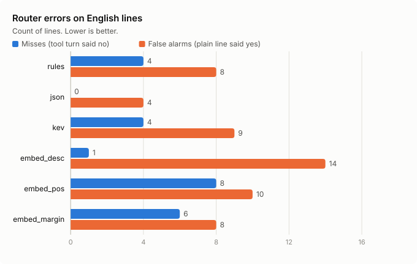

# Experiment 7: which router finds tool turns, in English and Japanese

Experiment 7 of 12 in a one-day series on Qwen3.5-9B thinking and tool calls in CetiMind, run on 2026-11-15 and first written up in CetiMind #51 (private repo). All test lines are hand-written, so no real chat or memory is in this directory.

Experiment 6 showed that tool turns need thinking. This experiment asks how to find those turns cheaply before the reply. Setup: same machine and GPU, LM Studio with `qwen/qwen3.5-9b`, and Kev `kev-0.8b` on CUDA called directly. Embeddings came from `nomic-embed-text-v1.5` through CetiMind's own `LlmClient.embed_query` and `embed_document` (prefixes `search_query: ` and `search_document: `).

## Labeled set

- **English:** 60 lines written by hand. 30 are positive, meaning the turn needs `schedule_create`, `schedule_list` or `schedule_cancel`: 20 create, 4 list, 4 cancel, and 2 that only make sense after an assistant line ("yes please" after an offer to remind, "make it 2pm instead" after a confirmation). 30 are negative: small talk and math, plus hard cases that mention time, reminding or a schedule without asking for a job, such as "can you remind me what we talked about?", "i have a dentist appointment tomorrow at 3", "every day at 8am I go for a run", "i set an alarm on my phone already" and "my schedule is so packed this week ugh". Two negatives follow an assistant line ("no thanks", "thanks!").
- **Japanese:** the same 60 lines and labels, translated by Claude (not checked by a native speaker).
- `current_time` does not count as a tool turn, because the prompt already has a clock line.
- Every line was run once (n = 1). The full lists are in the script and JSON below.

## Routers

- **rules:** an English regex of reminder words (`remind`, `ping me`, `in N minutes`, `every day`, `cancel` …). Yes when it matches.
- **json:** one `chat/completions` call to the 9B with `reasoning_effort: "none"`, `temperature` 0 and a strict schema `{"tool": boolean}`. The prompt is the question below, five examples, and the conversation as `Assistant: …` / `User: …`. The prompt is in English for both languages.
  > Is the user asking to set, change, list, or cancel a reminder or scheduled message, or agreeing to one that was just offered?
- **kev:** a `noul` question to Kev, with the same question text and the same `Assistant:` / `User:` state.
- **embed_desc:** the highest cosine between the user line and the three tool descriptions.
- **embed_pos:** the highest cosine to five "yes" anchor lines.
- **embed_margin:** the highest cosine to the five "yes" anchors, minus the highest cosine to five "no" anchors. The anchors are English and none of them is a test line.
- **embed_local** (Japanese only): `embed_margin` with Japanese anchors.

For the embeddings, the user line is turned into a query the same way CetiMind's `_context_query` does: a line under 6 words gets the last assistant reply in front of it.

**Thresholds:** for kev and the embeddings, the threshold is the one with the fewest errors on the whole set, with ties going to fewer misses. That makes those numbers optimistic. For English, a split-half check was also run: tune on the even lines and score the odd ones, then the other way round, and add up the errors.

## Results

A miss is a tool turn the router said no to. A false alarm is a normal line it said yes to.

| Router | EN misses | EN false alarms | EN split-half (misses/false alarms) | JA misses | JA false alarms | Median latency |
| --- | --- | --- | --- | --- | --- | --- |
| rules | 4 | 8 | n/a | 30 | 0 | 0 ms |
| **json** | **0** | **4** | n/a | **2** | **2** | 1735 ms EN, 1752 ms JA |
| kev | 4 (cut 0.526) | 9 | 7/10 | 6 (cut 0.589) | 4 | 958 ms EN, 881 ms JA |
| embed_desc | 1 (cut 0.549) | 14 | 3/14 | 3 (cut 0.456) | 25 | about 60 ms |
| embed_pos | 8 (cut 0.589) | 10 | 11/9 | not computed | not computed | about 60 ms |
| embed_margin | 6 (cut 0.039) | 8 | 8/10 | 8 (cut -0.004) | 10 | about 60 ms |
| embed_local | n/a | n/a | n/a | 7 (cut 0.061) | 8 | about 60 ms |

<picture>
  <source media="(prefers-color-scheme: dark)" srcset="charts/english-dark.svg">
  
</picture>

**Two-stage (English):** the second check runs only on lines the rules matched. 34 of 60 lines went to it.

| Second check | Misses | False alarms |
| --- | --- | --- |
| json | 4 | 3 |
| kev | 4 | 7 |
| embed_margin | 6 | 4 |

All the misses here are lines the rules never matched.

**json errors:**

- **English, false alarms:**
  - "can you remind me what we talked about?"
  - "remind me, what's your name again?"
  - "i'll be back in 20 minutes"
  - "thanks!" after "Done, I'll ping you at 9."
- **Japanese, misses** (both are list or cancel requests):
  - 今夜何か設定してくれた？ ("did you set anything for tonight?")
  - 姿勢の声かけはもう止めて ("stop the posture nudges")
- **Japanese, false alarms** (both are short replies right after the assistant's reminder line):
  - いや、いいよ ("no thanks") after an offer to remind
  - ありがとう！ ("thanks!") after a confirmation

## Reading

- **The JSON check is the only router that works in both languages,** and it costs about 1.75 s on the shared 9B.
- **A false alarm only costs a few seconds of thinking.** The model still sees the tools and can decide not to call one.
- **A miss is the expensive error,** because it leads to a false "it's set" reply.
- **Kev and the nomic v1.5 embeddings overlap too much** between tool turns and hard negatives in both languages, even with thresholds tuned on the test set.
- **Japanese anchors barely helped the embedding** (7/8 against 8/10). A multilingual embedding model was not tested, because none is installed.
- **The English rules can only be trusted for "yes"** in English. They match no Japanese line at all.

## Limits

- **Small, single runs:** one run per line, and 60 hand-written lines per language.
- **Machine translation:** the Japanese is Claude's translation, not a native speaker's.
- **English-only check prompt:** the JSON prompt and its examples are in English for both languages.
- **Optimistic thresholds:** Kev and embedding thresholds were tuned on the same lines they were scored on.
- **Shared GPU:** latency was measured on one GPU shared by Qwen and Kev, one request at a time.
- **No Japanese split-half check:** it crashed with no rule hits, so the Japanese numbers come from the saved JSON log.

## Setup

Shared by the whole series (CetiMind #51, private repo):

- **Date:** 2026-11-15.
- **Machine:** one Windows 11 PC with one NVIDIA GeForce RTX 4070 (12 GB). LM Studio and Kev shared this GPU (about 11.1 to 11.4 GB of 12.3 GB used).
- **LLM server:** LM Studio, OpenAI-compatible API on the same PC (shown as `http://localhost:1234/v1` in the scripts).
- **Chat model:** `qwen/qwen3.5-9b`, GGUF `Q4_K_M`. Loaded instance config from LM Studio's `GET /api/v1/models`:
  ```json
  {"context_length":8192,"eval_batch_size":2048,"physical_batch_size":512,"parallel":4,"flash_attention":true,"lazy_mode":"auto","context_checkpoints":32,"reasoning_budget_message":"","speculative_draft_mtp":false,"speculative_draft_simple":false,"speculative_draft_model":"","offload_kv_cache_to_gpu":true}
  ```
- **Kev:** `kev-0.8b` on CUDA, loaded on the same GPU, called directly at its `/v1/systemone` endpoint where an experiment uses it.
- **CetiMind:** `main` with the schedule tools that were committed as `9736301` (`schedule_create` with `in_seconds`, `at`, `daily_at`, `every_minutes`, `weekdays`, `tools`, `times`). Prompts come from CetiMind's own `build_prompt` with a character persona, unless an experiment says otherwise.
- **Chat settings:** `temperature` 0.7, `max_tokens` 4096, unless an experiment says otherwise.
- **Thinking switch:** `reasoning_effort` `"low"` for on and `"none"` for off (see [thinking-switch-2026-11-15](../setup-notes/thinking-switch-2026-11-15/README.md)). A reply thought if `reasoning_tokens` was above 0 or `reasoning_content` was non-empty.
- **Client:** Python 3.14 through `uv run` in the CetiMind venv, with `httpx2`. Times are client wall clock around one HTTP request.
- **Load:** one request at a time from one client. No CetiMind app was sending turns.
- **Test lines:** all hand-written. The Japanese lines are Claude's translations, not checked by a native speaker.

## Files

- [`routerprobe.py`](routerprobe.py): Experiment 7 script (routerprobe.py; run with no argument for English, `ja` for Japanese)
- [`multilang-ja.json`](multilang-ja.json): Japanese set (multilang.json, the ja part)
- [`routerprobe.jsonl`](routerprobe.jsonl): English (routerprobe.jsonl)
- [`routerprobe-ja.jsonl`](routerprobe-ja.jsonl): Japanese (routerprobe-ja.jsonl)

## Series

Twelve experiments on one day, behind CetiMind's per-turn thinking and tool routing design:

1. [thinking-switch](../setup-notes/thinking-switch-2026-11-15/README.md): which request field turns thinking on
2. [kev-reasoning-check](../kev-reasoning-check-2026-11-15/README.md): Kev 0.8B as a "needs reasoning" check
3. [schedule-tool-calls](../schedule-tool-calls-2026-11-15/README.md): schedule tool calls with and without thinking
4. [thinking-off-steps](../thinking-off-steps-2026-11-15/README.md): intent check and argument extraction with thinking off
5. [thinking-cap-fields](../setup-notes/thinking-cap-fields-2026-11-15/README.md): can a request field cap thinking
6. [tool-call-examples](../tool-call-examples-2026-11-15/README.md): example tool calls, and asking for brief thinking
7. [tool-turn-router](../tool-turn-router-2026-11-15/README.md): which router finds tool turns, English and Japanese
8. [generic-tool-picker](../generic-tool-picker-2026-11-15/README.md): stub tools next to the schedule tools
9. [hidden-tool-calls](../hidden-tool-calls-2026-11-15/README.md): are thinking-on misses hidden in the reasoning
10. [missed-tool-check](../missed-tool-check-2026-11-15/README.md): which check catches a reply that skipped a tool
11. [prompt-cache-layout](../prompt-cache-layout-2026-11-15/README.md): prompt caching by layout and tool set
12. [forced-tool-choice](../forced-tool-choice-2026-11-15/README.md): forcing the chosen tool with thinking off
